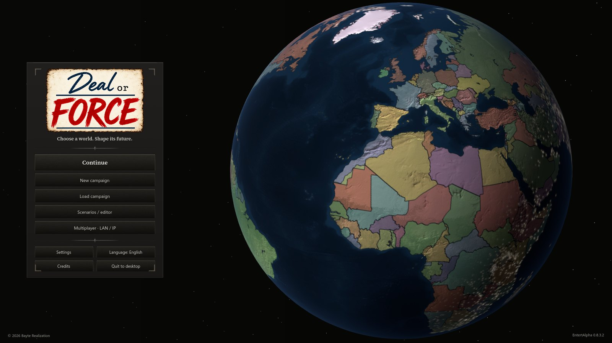
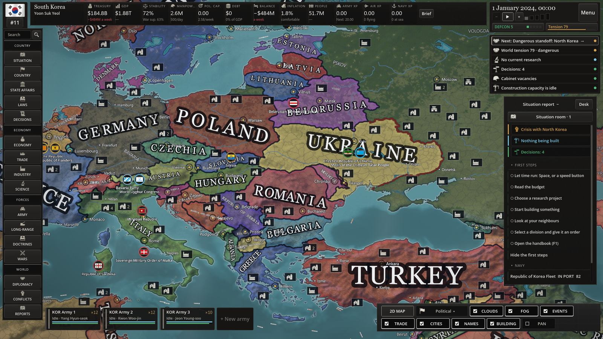
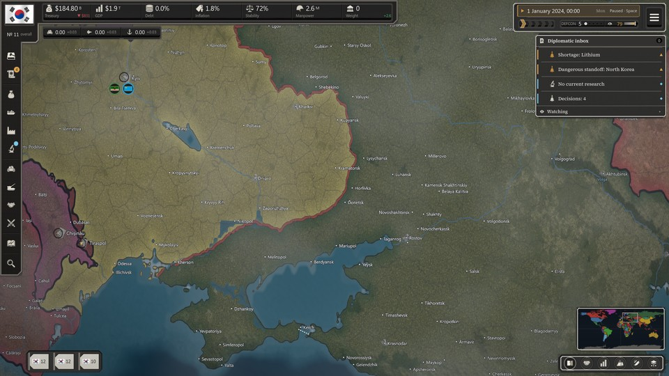
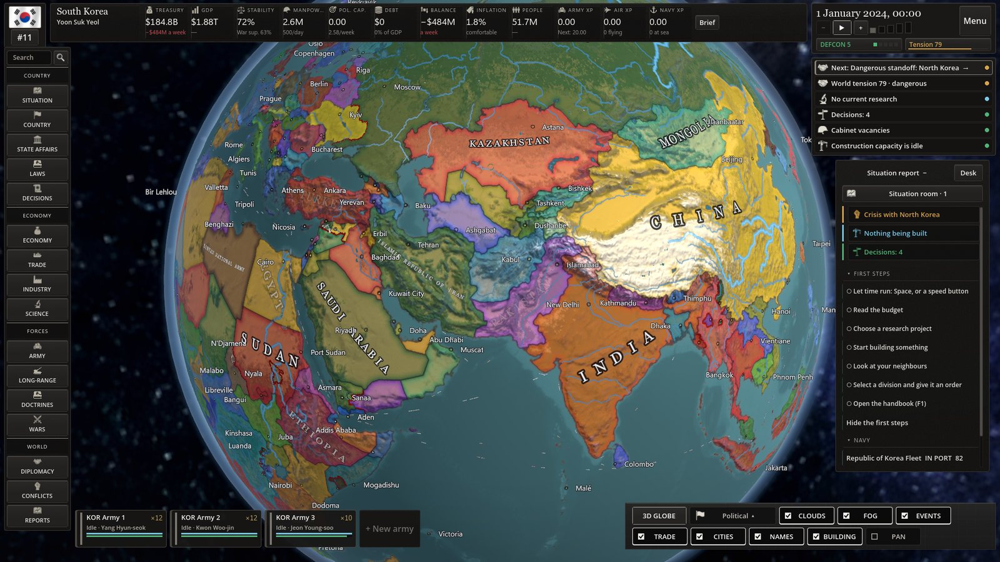
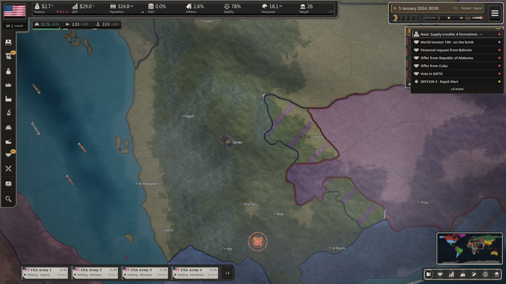
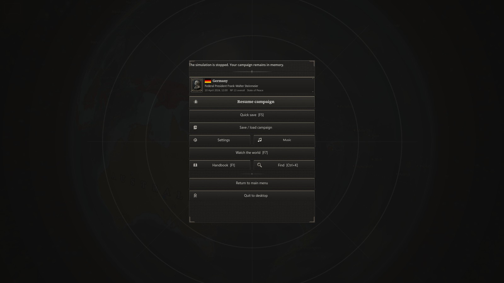

[English](README.md) · [Русский](README.ru.md)

# Deal or Force

**A grand strategy game about the whole world, from the morning of 1 January 2024.**
Every country on the map is yours to play, and the computer runs the others with the same
commands for most actions; the [differences that remain](docs/PLAYER_AI_PARITY_2026_11_18_RU.md)
are being closed one at a time, peace first. Version **0.8.5.3** (EntertAlpha).

[](docs/CHANGELOG_0.8.5.3_EN.md)
[](docs/GETTING_STARTED.md)
[](docs/GETTING_STARTED.md)
[](LICENSE)
[](https://bayte-realization.itch.io/deal-or-force)



| | |
|---|---|
|  |  |
|  |  |
|  |  |
|  |  |
|  |  |
|  |  |

## Play it

- **Published Windows builds** (64-bit, English and Russian) are on
  [itch.io](https://bayte-realization.itch.io/deal-or-force).
  Extract the whole archive and run `Deal or Force Launcher.exe`.
- **From source** — see [Building and running](#building-and-running) below.
- The [cumulative 0.8 changelog](docs/CHANGELOG_0.8.5.3_EN.md) covers the new interface, game
  rules and performance work, along with the latest fixes.
- It is built by one person, openly with the help of AI.

Follow the project: [YouTube](https://www.youtube.com/@BayteRealization) ·
[X](https://x.com/Bayte_R) · [TikTok](https://www.tiktok.com/@bayte_realization) ·
[Telegram](https://t.me/+39SNXyA92aBmYzhi) · [devlog](https://bayte-realization.itch.io/deal-or-force/devlog)

## New in EntertAlpha 0.8.5.3

Built on **Godot 4.8 Beta 3 .NET** and **.NET 10**. The full history of the 0.8 series is in
[CHANGELOG 0.8.5.3](docs/CHANGELOG_0.8.5.3_EN.md).

- **The day is calculated on its own thread, Release Server GC & `.dofsave`.** Without runtime-code mods and
  without multiplayer, the map and panels keep drawing from a lock-free `CampaignHudSnapshot` while
  the next day is worked out, draining heavy HUD views within a `1.5 ms` frame budget (`1.25 ms` on
  mobile). Exported PC builds enable `System.GC.Server`, `System.GC.Concurrent`, `Optimize`, and
  `TieredPGO` in Release too, saves prepare and commit off the main thread (`RequestYield`) using the
  canonical **`.dofsave`** extension (with seamless loading of legacy `.dfsave`, `.bdfsave`, and
  `.bdfsave.json` saves), and pure-data mods no longer disable background simulation.
- **Zero-stutter map, Country Highlight & Capital jump.** Moving the camera keeps full shader
  resolution and 3D terrain relief without dropping detail mid-motion. Dynamic map overlays
  moved from per-frame `ImmediateMesh` rebuilds to dirty-versioned indexed `ArrayMesh` surfaces,
  `RBush` R-tree spatial culling handles 7,000+ cities, rivers and labels, `CloudShader` cuts
  fragment octaves from 16 to 9 per pixel, and **Spin** (`F6`) returns to the map bar. Inspecting
  any country in the Country Panel (yours or foreign) highlights its full territory with a crisp
  parchment lift and zoom-invariant outline across both Forward+ and GLES3 shaders; clicking any
  row in **Country Rankings** flies the camera directly to its capital; and general territory
  badges/tooltips use **"Controlled"** wording across war occupation and land leases.
- **100-year cyclical history, interstate dynamism & diplomatic readouts.** Multi-decade campaigns
  stay alive across century horizons: blocs dissolve or fracture under intra-bloc rivalry and
  claims, active diplomacy confronts rivals and transitions expired truces cleanly to `Rival` or
  `Neutral`, revanchism over lost homelands and follow-up wars on conquered rumps drive reckonings,
  and rising expectations, Juglar/Kondratiev economic/debt cycles, and institutional sclerosis fuel
  recurring crises, secessions, collapses, and regime evolution. Country Dossier and Diplomacy now
  surface **Truce countdowns**, **Lost Homeland / Revanchism** warnings, and the active **Global Era**,
  protected by `TryEnterRead` fences in `MovementUI` and Diplomacy screens.
- **Multi-decade & late-game scaling on .NET 10.** An active-wars index skips finished wars,
  tiny/duplicate population cohorts coalesce deterministically, expired opinions/memories/history
  prune over decades, late-game organization life, identity caching, corridors, and long-range
  repositioning shed O(M³) scans and allocations, and pure-managed MIT/Apache-2.0 packages
  (`RBush`, `DotNext`, `ZeroAlloc.Collections`, `SimdLinq`, `Equativ.RoaringBitmaps`,
  `Ben.Demystifier`, `ZLinq`, `System.IO.Hashing`, `BitFaster.Caching`, `RecyclableMemoryStream`,
  `CommunityToolkit.HighPerformance`, `System.Numerics.Tensors`, `K4os.Compression.LZ4`) cut
  allocations. In the 10-year `SimBench` run (seed 42), Year-10 step time dropped from **97.3 to
  78.8 ms/day**, worst Year-10 spike from **331 to 156 ms**, Year-10 Gen0 collections by **61.5%**
  (13 → 5), and Day-365 allocation by **35.1%** (4145 → 2690 kB/day); on a real Day 13,358 save,
  `organization life` fell from **5.2% to 1.7–1.8%** (`185 → 59 ms` pre-throttle) and daily
  allocations fell from **5,810 to 5,375 kB/day**.
- **Android build (Galaxy S21 / S22 Exynos crash fix & PC-faithful visuals).** The same simulation
  with touch controls, GLES3 (`gl_compatibility`, `msaa_3d=0`, single-safe `thread_model=1`),
  eliminated post-menu `pthread_mutex_lock` teardown crashes (safe `RefCounted`/prewarm lifecycle,
  deferred scene warmup, `DUMMY` unused physics), `/proc/meminfo` physical RAM detection so 6+ GB
  flagships (`Xclipse 920`, `Mali-G78`, `Adreno`) run at PC-faithful **`MobileMedium`** quality
  instead of degraded `MobileLow`, `HeapHardLimitPercent=75`, zero-PNG 3-tier LZ4 fast boot cache,
  and synchronous `boot_trace.txt` / `last_crash.txt` logs in
  `Android/data/com.bayterealization.dealorforce/files/logs/`. Still a technical preview you
  install by hand; phone-specific UI scaling remains partial.
- **Terrain relief, Country Picker & clearer dossiers.** Armies, cities, front lines, battles and
  labels sit at ground height. The Country Picker adds a 16/24-row scrollable list and an
  unclipped 6-stat dossier with Prestige; Display settings show the live GPU/renderer and
  troubleshooting guidance. The country dossier has a clickable Capital row and domestic
  stability outlook, Economy warns on tax efficiency, and splinter states draw from 36 colours.
- **New mechanics, not yet balanced by measurement.** Prestige (0–1000) in rankings and
  diplomacy, GDP-scaled event costs, systemic divided-nation reunification, megaprojects that
  allies can co-fund, world situations, national ambitions and cabinet directives, switchable
  production methods, diseases and disasters, more doctrines, and the Mod Content Studio.
- **AI staff and diplomatic inbox (0.8.3.5).** Hand any of 11 areas of government to your own staff
  from the AI Staff tab of your country dossier (`Q`) or from State Affairs (`E`). Incoming letters
  from all 9 diplomatic channels wait in a bar under the date at the top right.
- **Map and menu fixes (0.8.3.4).** Army counters stay steady at a fixed zoom and no longer flash
  through the far side of the globe. Closing a region's dossier clears the map highlight, and menu
  ornaments stay behind the window that covers them.
- **New campaign interface (0.8.3.2).** Five matte surfaces (leather, slate twill, laid paper,
  blueprint grid, archive linen) that a mod can replace, a Continue card with the country's flag in
  the main menu, a pause desk with the ruler, date and war status, a searchable save archive, a
  Society tab in the country dossier, full-width front cards in the war ledger, and a Long-Range
  Forces button on the left rail.
- **Wars that end (0.8.3.2).** Full occupation or a decisive war score now settles an interstate
  war instead of letting it drag on. A human victor receives the capitulation as an offer. A
  defeated human player can at present have it signed for them; giving that decision back is on
  the plan.
- **Speed 5 (0.8.3.2).** Heavy simulation stages leave room for drawing and input. In a development
  benchmark at the 2024 start, Speed 5 went from 2.61 to 6.53 days per second and the longest
  simulation frame from 661.9 to 27.3 ms. In-game speed depends on the save, settings and hardware.

## The game

It opens on 1 January 2024 with hundreds of countries and movements, thousands of regions
and 34 138 provinces. Authored history sets the starting conditions; simulation rules and
events then shape the campaign. Prices come out of what is produced and shipped. A war moves
a front province by province and has to be supplied along it. A country that governs badly
loses regions to people who would rather leave. You can play any country on the map.

## What is in it

The world is one simulation rather than a set of screens. Sixty-three goods are made by 94
recipes and traded between countries; an embargo or a war cuts the trade between the two, so
it takes away goods rather than a number. Trade is reached by distance, not sailed through
straits: a strait or canal held by an enemy closes to fleets and convoys, and a hostile
supplier of a key good slows the megaprojects that need it. Peace is written at a conference:
every province you mean to keep is priced in war score, and the screen tells you why a demand
cannot go through.

Countries answer to each other in more than one way. Alliances are proposed and can be
turned down. A frightened country goes and asks somebody larger for a guarantee. Seven kinds
of dependency (protectorate, puppet, satellite, dominion, special administrative region,
client state, personal union) each take their own
tribute, bring their own obligations in war, and drift towards wanting out at their own
pace. NATO, the CSTO and a dozen standing guarantees are on the map from the first morning,
because they were.

The wars of 2024 that were not between states are on the map from the first day: the Rapid
Support Forces in Darfur and Khartoum, the Houthis in Sanaa, Idlib, north-eastern Syria, the
east of Libya, Myanmar's resistance, al-Shabaab, the M23 - each a country with its own ground
and fighters, in the war, truce or peace it had that morning. A civil war is fought by its
two sides, and their friends arm them rather than join them; a faction that takes the capital
takes the state. Between the wars every pair of countries carries a tension that rises
through crisis to armed clashes, and a border that keeps shooting can become a few weeks'
border war ending in a ceasefire. Unstable governments face military coups.

Regions secede when nobody is governing them. Governments fall and are replaced. Armies grow
when a country has reason to arm and are sent home when it does not, instead of staying the
size they started. A threatened region raises its own militia, in its largest town and under
that town's name.

A war is fought from the air as well as on the ground. Artillery, rocket batteries, aircraft,
drones and air defence are formations of their own, based in regions and sent on missions from
a panel beside the map; they reach into the battles within their range and pay for every day
they fly over a defended front. There are 136 technologies, and they spread from the countries that know
them to their neighbours and partners.

The map reads like an atlas: more than seven thousand cities that never print over each other,
relief lit from the north-west, a sea with shelves and a floor, and coasts and borders drawn as
the lines they were digitised from rather than as the texel staircase they are stored as.

Saves are text a person can open and edit, and a campaign started from a chosen seed rebuilds
the same world.

And everyone flies the right flag: about a thousand of them, chosen by what a country has become — its
people, its ideology, its form of government, whether it answers to somebody else — and
declared by nothing but the file name.

## Modding

Nearly everything is data. `game/common` holds goods, buildings, recipes, ideologies,
governments, decisions, modifiers and the numbers that balance them; `game/history` holds
what the world was on day one; `game/localization` holds every string the game shows, in
English and in Russian, complete.

A mod puts its own files beside the base game's and wins by load order, so changing three
numbers never means forking a file:

```
mods/my_mod/
  mod.json
  common/defines/economy.json     only the keys it names
  events/my_events.json
  localization/russian.json
```

Effects are data too, not code:

```json
"effects": { "treasury_percent": -0.06, "stability": 0.018, "state.radicalism": -0.01 }
```

A bare number adds, `_percent` scales, `_mult` multiplies, `_set` assigns, and the `state.`
prefix applies the effect to every region of the country. `mods/_templates` has worked
examples at all three levels: JSON, GDScript, compiled C#. The rest is in
[MODDING_GUIDE](docs/MODDING_GUIDE.md).

## Language development kit

The project retains source integrations for **Luau, F#, Nim, Odin, Rust and Kotlin**.
See the [kit and build recipes](LanguageKit/README.md) and
[support levels / migration policy](docs/LANGUAGE_BACKENDS_RU.md). All six ran together
in the Godot 4.8 Beta1 .NET workbench; this does not certify every export or API.
The campaign remains C#. Rust is reserved for rare, measured hard cases; players and
ordinary data-mod authors do not need six toolchains.

## Building and running

**[docs/GETTING_STARTED.md](docs/GETTING_STARTED.md) is the full account**, written for
somebody who has never opened this project. The short version:

You need **Godot 4.8 Beta 3 in its .NET build** (`Godot.NET.Sdk/4.8.0-beta.3`) — the plain download will open
the project and find no scripts — and the **.NET SDK 10**.

```bash
git clone https://github.com/Bayte-Realization/deal-or-force.git
cd deal-or-force
dotnet build DealOrForce.csproj
```

Then open the folder in Godot and press **F5**. The game opens on `Scenes/MainMenu.tscn`,
which is a scene of its own and comes up immediately; the world is built when you ask for a
campaign, which takes ten to thirty seconds.


**Before trusting a change**, play a campaign without the engine and check it against about a
hundred invariants: that the economy adds up, that two identical worlds stay identical, that
a front has not quietly stopped being contested.

```bash
dotnet run -c Release --project Tools/SimBench/SimBench.csproj -- 730
```

To build a copy somebody else can double-click — this needs Godot's export templates
installed, see [docs/BUILDING.md](docs/BUILDING.md):

```powershell
powershell -ExecutionPolicy Bypass -File Tools\build.ps1
```

## If it will not start

The game watches its own start (`Scripts/Boot/boot_guard.gd`, which runs even when the C#
half does not). If a start never reaches the menu, or the menu comes up black, it moves to a
simpler renderer by itself and starts again: Direct3D 12, then Vulkan, then OpenGL, then OpenGL
through Direct3D 11 (ANGLE), which draws on nearly any graphics card of the last fifteen years.
If the game's code does not load - a build copied without its `data_DealOrForce_windows_x86_64`
folder, or one an antivirus has quarantined part of - it says so on screen rather than staying
black.

- The choice is kept in `%APPDATA%\Godot\app_userdata\Deal or Force\graphics_override.cfg`.
  Delete it to go back to automatic, or pick a renderer in *Settings → Display → Graphics
  renderer*.
- To start on one directly: `"Deal or Force.exe" --rendering-method gl_compatibility`.
- The log is `%APPDATA%\Godot\app_userdata\Deal or Force\logs\godot.log`; step-by-step boot and
  demystified crash traces (`boot_trace.txt`, `last_crash.txt`) are written to
  `Documents\Bayte Realization\Deal or Force\logs\` on PC and
  `Android/data/com.bayterealization.dealorforce/files/logs/` on Android.
- `"Deal or Force.exe" -- --boot-guard-pretend-black` walks the whole chain on a machine whose
  drivers all work, for testing.

## Documentation

Everything below exists in English and in Russian; a `_RU` suffix is the Russian one, and
[docs/README.md](docs/README.md) is the full index.

| | |
|---|---|
| [Changelog 0.8.5.3](docs/CHANGELOG_0.8.5.3_EN.md) · [0.8.3.5](docs/CHANGELOG_0.8.3.5_EN.md) · [0.7.2.3](docs/CHANGELOG_0.7.2.3_EN.md) | **cumulative 0.8 release notes and previous changelogs** |
| [Overhaul programme](docs/OVERHAUL_PROGRAMME_2026_11_14_RU.md) | the fifteen fronts of the rework and what "done" means for each (Russian) |
| [Deal rework](docs/DEALS_REWORK_2026_11_14_RU.md) | what is wrong with deals today and the plan for them, step by step (Russian) |
| [TUTORIAL](docs/TUTORIAL.md) | **your first campaign, hand held** |
| [MODDING_QUICKSTART](docs/MODDING_QUICKSTART.md) | **your first mod in fifteen minutes** |
| [GETTING_STARTED](docs/GETTING_STARTED.md) | how to run and build it |
| [PLAYER_GUIDE](docs/PLAYER_GUIDE.md) | how to play |
| [MODDING_GUIDE](docs/MODDING_GUIDE.md) | how to change it |
| [ARCHITECTURE](docs/ARCHITECTURE.md) | how it is built |
| [CSHARP_GUIDE](docs/CSHARP_GUIDE.md) | **C# from scratch, taught on this game's own code** |
| [NETWORK_MULTIPLAYER](docs/NETWORK_MULTIPLAYER.md) | LAN and direct IP |
| [CONFLICTS_AND_FACTIONS](docs/CONFLICTS_AND_FACTIONS.md) | tension, border wars, proxy wars, de facto powers, coups |
| [October 8 changes](docs/RELEASE_2026_10_08_RU.md) | verified changes and limitations (Russian) |
| [Development roadmap](docs/DEVELOPMENT_ROADMAP_2026_10_08_RU.md) | coherent redesign, remaining work and acceptance criteria (Russian) |
| [Campaign integrity](docs/CAMPAIGN_INTEGRITY_RU.md) | overflow cause, autosave protection, compression and compatibility (Russian) |
| [Sovereign finance](docs/SOVEREIGN_FINANCE_RU.md) | financial workspace, legacy overdraft conversion, arrears and bounded issuance (Russian) |
| [Institutions](docs/INTERNATIONAL_ORGANIZATIONS_RU.md) | organizational charters, fund, votes and defence (Russian) |
| [Territory and independence](docs/TERRITORY_AND_RELEASE_RU.md) | homeland titles, treaty releases and Bir Tawil (Russian) |
| [Households](docs/HOUSEHOLD_ECONOMY_RU.md) | employment, basic needs and demographic dynamics (Russian) |

## Found a bug?

Press **Settings → Report a problem** in the game (or type `report` in the console). It writes
`DealOrForce-report-….zip` into `Documents\Bayte Realization\Deal or Force\reports\` with the
build, the last logs, your settings and the newest save - attach it to a
[bug report](https://github.com/Bayte-Realization/deal-or-force/issues/new?template=bug_report.yml).
Ideas and questions go to [Discussions](https://github.com/Bayte-Realization/deal-or-force/discussions).

## Known debts

- The map rasters ship twice: Godot imports all 319 PNGs into the `.pck`, and they are also
  laid down as ordinary files because part of the code reads them directly. Tens of
  megabytes nobody needs.
- The interface is built in code, though where every panel sits is declared in
  `game/gui/` and the palette in `game/interface/`, so a reskin needs no compiler.
- No host migration in multiplayer: losing the host ends the session.

## Third-Party Frameworks, Libraries & Open Data — Acknowledgements

Deal or Force stands on the shoulders of extraordinary open-source engineers, language designers,
cartographers, typographers, and Wikimedia contributors. Every single library, runtime, dataset, and
tool listed below makes this project faster, sharper, and possible for one person to build — thank you
sincerely to every creator and maintainer! Full copyright texts and licence terms live in
[`game/THIRD_PARTY_NOTICES.md`](game/THIRD_PARTY_NOTICES.md) and inside the in-game **Credits** screen.

| Component / Dataset | Creators & Maintainers | Role in Deal or Force | Licence |
|---|---|---|---|
| **Godot Engine 4.8** (`4.8.0-beta.3` .NET) | Juan Linietsky, Ariel Manzur & Godot Engine contributors | Rendering, 3D globe, shaders, scene tree, cross-platform PC & Android runtime | MIT |
| **Jolt Physics / Godot Jolt** | Jorrit Rouwe, Mikael Hermansson (`mihe`) & contributors | 3D physics engine configured for desktop builds (`project.godot`) | MIT |
| **.NET 10**, **WPF**, **`System.IO.Hashing`**, **`System.Numerics.Tensors`**, **`RecyclableMemoryStream`** | Microsoft Corporation & .NET Foundation contributors | Managed simulation runtime, Launcher UI, `XxHash3` hashing, SIMD tensor math, pooled save/cache streams | MIT |
| **F# & `FSharp.Core`** (10.1.402) | Don Syme, Microsoft & F# Software Foundation | Pure functional rules assembly (`DealOrForce.Rules`) | MIT |
| **`ZLinq`** (1.6.1) & **`SimdLinq`** (1.3.2) | Yoshifumi Kawai (`neuecc`) / Cysharp, Inc. | Zero-allocation value enumerables and SIMD-accelerated reductions | MIT |
| **`CommunityToolkit.HighPerformance`** (8.4.2) | Sergio Pedri, Microsoft & .NET Foundation | High-throughput spans, pools, and contiguous matrix buffers | MIT |
| **`DotNext`** (6.13.0) | Roman Sakno (`sakno`), .NET Foundation & Contributors | Low-allocation primitives and lock/threading utilities | MIT |
| **`BitFaster.Caching`** (2.6.1) | Alex Peck | Concurrent LRU caches in map boot and simulation lookups | MIT |
| **`ZeroAlloc.Collections`** (2.0.1) | Marcel Roozekrans | Pooled & stack-friendly collections on hot campaign paths | MIT |
| **`Equativ.RoaringBitmaps`** (0.1.6) | Equativ.RoaringBitmaps Contributors (Roaring Bitmap format by Daniel Lemire et al.) | Compressed integer bitsets in simulation indexes and caches | Apache-2.0 |
| **`RBush`** (4.0.0) | Daniel Newman / Turning Code (`viceroypenguin`) & Vladimir Agafonkin (JS RBush) | R-tree spatial culling for 7,000+ cities, rivers, capitals, and labels | MIT |
| **`K4os.Compression.LZ4`** & **`.Streams`** (1.3.8) | Milosz Krajewski & Yann Collet (LZ4) | Fast LZ4 save & boot raster compression | MIT / BSD-2-Clause |
| **`YamlDotNet`** (18.1.0) | Antoine Aubry & contributors | Modding YAML parsing and data workbench | MIT |
| **`Ben.Demystifier`** (0.4.1) | Ben Adams & contributors | Readable source-like crash traces in `last_crash.txt` | Apache-2.0 |
| **`Tracy Profiler`** & **`Tracy-CSharp`** (0.13.1) | Bartosz Taudul (`wolfpld`) & `clibequilibrium` | Optional opt-in frame & simulation zone profiling (`-p:DofTracy=true`) | BSD-3-Clause / MIT |
| **Roslyn (`Microsoft.CodeAnalysis`)** & `Tools/*Bench` Packages | Microsoft (`Microsoft.CodeAnalysis`, `Microsoft.Extensions.ObjectPool`, `System.Runtime.CompilerServices.Unsafe`); `genaray` (`Arch`, `Arch.LowLevel`, `ZeroAllocJobScheduler`); Joel Mueller (`Collections.Pooled`); Ullrich Praetz (`Friflo.Engine.ECS`); `neuecc`/`aarnott` (`MessagePack`/`MemoryPack`); Oleg Stepanischev (`ZstdSharp.Port`) | Dev-only static auditing (`Tools/CodeAudit`) and `Tools/KernelBench` / `Tools/SaveFormatBench` harnesses (not shipped) | MIT / Apache-2.0 / LGPL-3.0-only (dev-only) |
| **`LanguageKit/` Integrations** | **`godot-rust/gdext`** (Rust), **`Fumohouse/godot-luau-script`** (`voided_etc`, Luau), **`godot-nim/gdext-nim`** (Nim), **`dresswithpockets/odin-godot`** (Odin), **`utopia-rise/godot-jvm`** (Kotlin), **`gilzoide/lua-gdextension`** (Lua), **`libriscv/godot-sandbox`** (Sandbox), **`gdzig/gdzig`** (Zig), **`quaadgras/graphics.gd`** (Go), **`niklas2902/py4godot`** (Python) | Optional polyglot GDExtension & scripting workbench recipes (`LanguageKit/README.md`) | MIT / Apache-2.0 / MPL-2.0 / BSD-3-Clause |
| **Godot Editor Plugins (`addons/`)** | **Fennara**, **LimboAI** (Serhii Snitsaruk), **GodotSteam** (GP Garcia & Chris Ridenour), **Dialogue Manager** (Nathan Hoad), **Ezcha Network** (Ezcha LLC), **Lit** (Shawn Deprey), **Scalable Vector Shapes 2D**, **Script-IDE** (Marius Hanl), **Godot AI**, **GDQuest**, **Ziva Agent** | Local editor tooling excluded from Git and release builds (`addons/`) | MIT (and respective terms) |
| **`Source Serif 4`** | Frank Grießhammer / Adobe Systems Incorporated | Display and document serif typography (`game/fonts/NOTICE.txt`) | SIL OFL-1.1 |
| **ESA GlobCover 2009** | European Space Agency (ESA) & Université catholique de Louvain (UCLouvain) | Global land-cover classification for map terrain | Attribution required |
| **NASA Blue Marble & GEBCO** | Jesse Allen / NASA Earth Observatory & British Oceanographic Data Centre (BODC) | Topographic relief and ocean bathymetry | Attribution required |
| **Natural Earth** | Natural Earth contributors | Public-domain rivers, lakes, hydrography, cities, and base population inputs | Public Domain |
| **Wikimedia Commons Flags** | Wikimedia Commons illustrators (`game/gfx/CREDITS.md`) | Historical, national, regional, and movement flag artwork | PD / CC0 / CC BY / CC BY-SA |

Local workspace editor plugins under `addons/` (such as `Fennara`, `LimboAI`, `GodotSteam`, `Dialogue Manager`, `Script-IDE`, and `Scalable Vector Shapes 2D`) remain excluded from Git and keep their own respective licences.

## Licence

**GNU General Public License v3.0 or later** — full text in [`LICENSE`](LICENSE).

    Copyright (C) 2026 Bayte Realization

In practice: take it, read it, change it, pass it on — and if you pass on a changed version,
pass on its source under the same licence.

`addons/` is excluded from the repository and each plugin there carries its own licence.
Godot itself is MIT, which GPL accepts.

The flags in `game/gfx/flags` come from Wikimedia Commons. [`game/gfx/CREDITS.md`](game/gfx/CREDITS.md)
lists 632 of them file by file with their source, licence and author; the national flags, which
were rendered from the public-domain drawings Wikipedia uses, are not listed one by one yet, and
21 variants have no source recorded - [`game/THIRD_PARTY_NOTICES.md`](game/THIRD_PARTY_NOTICES.md) says which. A flag
as a symbol is usually public domain; a particular drawing of it need not be, which is why
the file exists.

The map is built from open data: land cover from ESA GlobCover, relief and the sea floor from
NASA Earth Observatory's topography and bathymetry (GEBCO data), rivers, lakes and cities from
Natural Earth. [`game/THIRD_PARTY_NOTICES.md`](game/THIRD_PARTY_NOTICES.md) gives each with its terms.

**Original artwork and audio are freely reusable.** Bayte Realization grants everyone
permission to use, copy, modify, distribute and sell the project's original artwork and
audio, including outside this game, without asking permission or paying royalties.
Attribution is appreciated, not required. This permission includes original interface
icons, textures, generated music/sounds and original flag illustrations. There is no
separate restrictive asset licence. The code's GPL terms are unchanged.

This grant covers only rights held by Bayte Realization. Third-party flags, fonts and map
inputs retain their own notices and licence conditions. Sources and unresolved provenance
are documented in [third-party media notices](docs/THIRD_PARTY_MEDIA.md) and
[flag credits](game/gfx/CREDITS.md). Reusing a logo does not imply endorsement by its author.

**Steam.** GPLv3 and the proprietary Steamworks SDK cannot both be satisfied at once, so an
additional permission under GPL §7 is granted for linking against it — see
[`LICENSE-EXCEPTIONS.md`](LICENSE-EXCEPTIONS.md). Nothing depends on it today: `godotsteam`
is local only and no line of the game talks to Steam. It is granted in advance because such
a permission needs every copyright holder's agreement, and that is easiest while there is
one.
