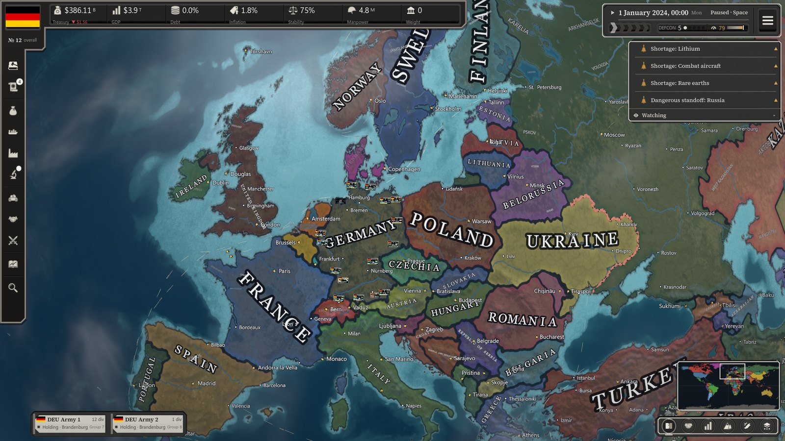
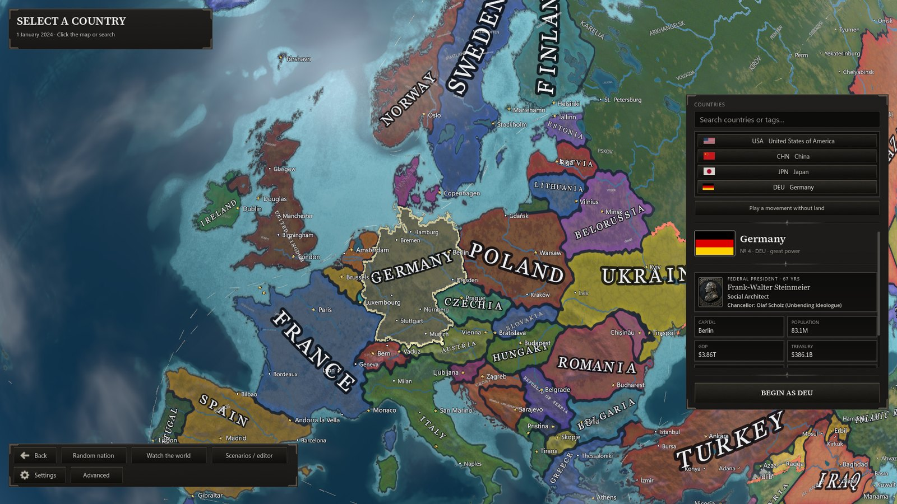
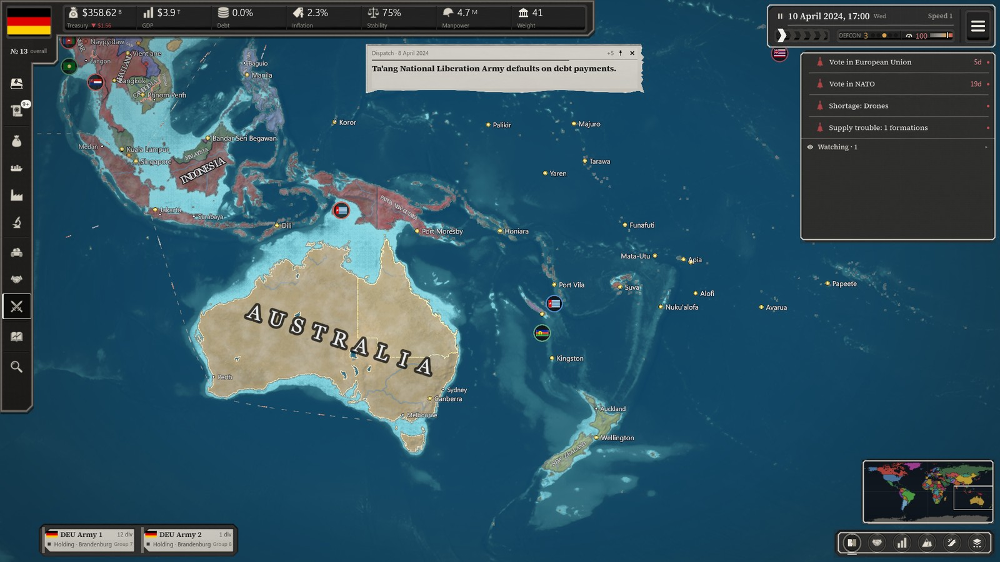
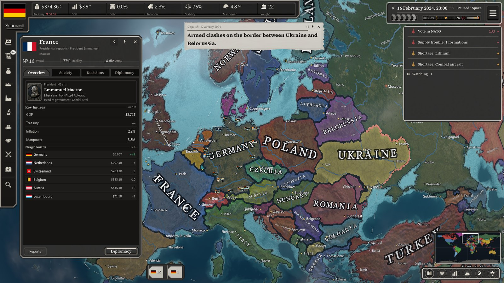
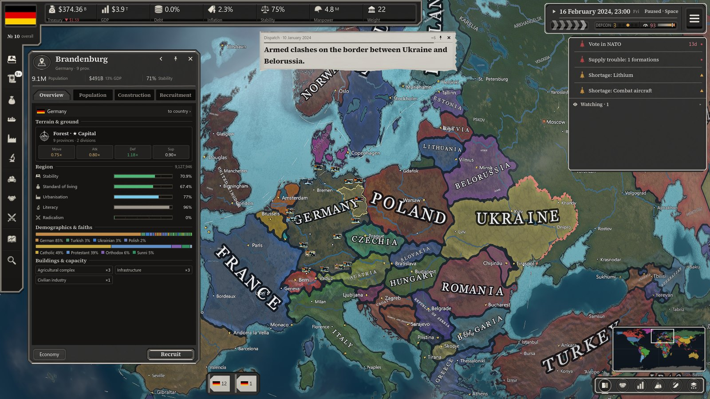
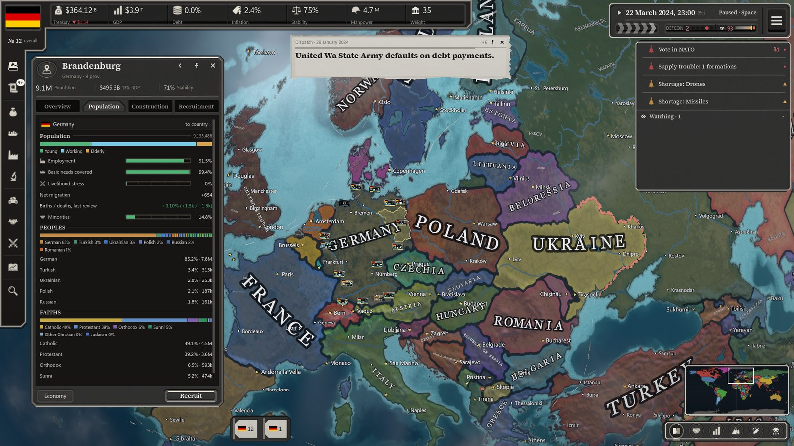
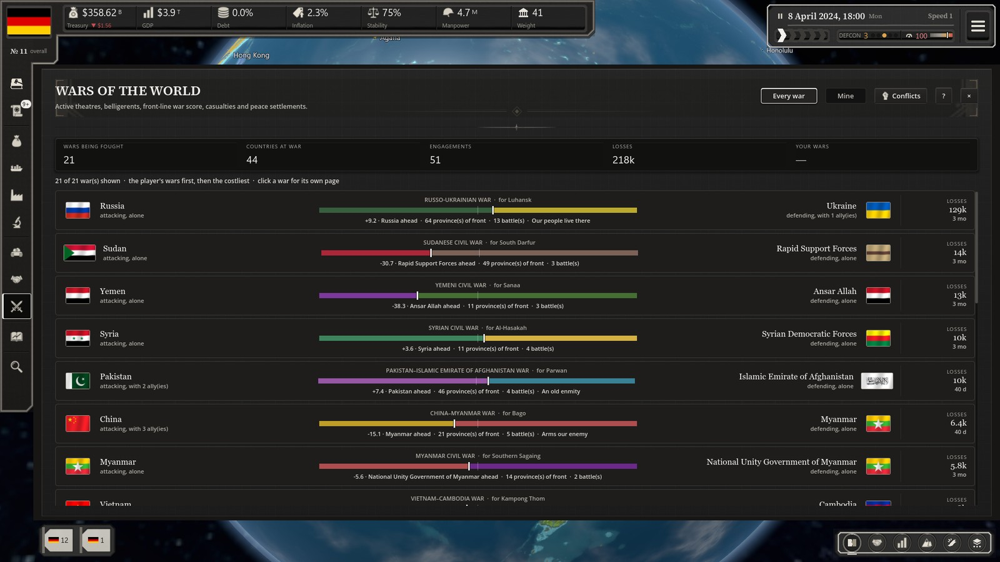
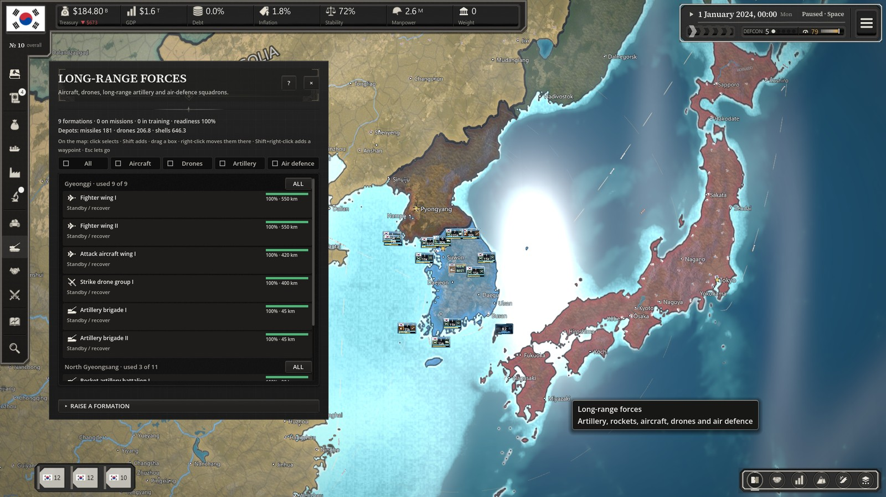

[English](README.md) · [Русский](README.ru.md)

# Deal or Force

**A grand strategy game about the whole world, from the morning of 1 January 2024.**
Every country on the map is yours to play, and every one of them is simulated the same way.
Version **0.8.5.3** (EntertAlpha).

[](docs/CHANGELOG_0.8.5.3_EN.md)
[](docs/GETTING_STARTED.md)
[](docs/GETTING_STARTED.md)
[](LICENSE)
[](https://bayte-realization.itch.io/deal-or-force)


| | |
|---|---|
|  |  |
|  |  |
|  |  |
|  |  |



## Play it

- **Published Windows builds** (64-bit, English and Russian) are on
  [itch.io](https://bayte-realization.itch.io/deal-or-force).
  Extract the whole archive and run `Deal or Force Launcher.exe`.
- **From source** — see [Building and running](#building-and-running) below.
- The [cumulative 0.8 changelog](docs/CHANGELOG_0.8.5.3_EN.md) covers the new interface, game
  rules and performance work, along with the latest fixes.
- It is built by one person, openly with the help of AI.

Follow the project: [YouTube](https://www.youtube.com/@BayteRealization) ·
[X](https://x.com/Bayte_R) · [TikTok](https://www.tiktok.com/@bayte_realization) ·
[Telegram](https://t.me/+39SNXyA92aBmYzhi) · [devlog](https://bayte-realization.itch.io/deal-or-force/devlog)

## New in EntertAlpha 0.8.5.3

Built on **Godot 4.8 Beta 3 .NET** and **.NET 10**. The full history of the 0.8 series is in
[CHANGELOG 0.8.5.3](docs/CHANGELOG_0.8.5.3_EN.md).

- **Zero-freeze background simulation & Android edition** — `DoF-Sim` background thread with
  stage-yielding `StepFor` slicing, non-blocking HUD/map reads, pre-baked map boot caches, `STORED(0)`
  APK packaging, touch controls, and pause-menu Developer Console with soft-keyboard adaptation.
- **Elevation-aligned 3D relief, Dossier clarity & colour fixes** — per-coordinate 3D relief
  snapping for armies, cities, capitals, weather/fog shells; clickable Capital navigation and
  expandable Domestic Stability factors in the Country Dossier; live Tax Efficiency warning banner
  in Economy; and 36 distinct splinter/civil-war country colours.
- **Major gameplay & modding wave** — Grand Projects, World Situations, National Ambitions &
  Cabinet Directives, multi-variant Production Methods, Diseases & Disasters, expanded Doctrines,
  Mainland Reclamation, and Mod Content Studio.

- **AI staff delegation & Diplomatic Inbox** — delegate any of the 11 branches of government from
  the dedicated **AI Staff** tab (`Q` / flag dossier, with an Overview shortcut) or the top
  **THE STAFF** block inside **State Affairs** (`E`); the **Diplomatic Inbox** now stays pinned at
  the top of the right HUD column beneath Date/DEFCON across all 9 incoming diplomatic channels.

- **Map and menu fixes** — army counters stay steady at a fixed zoom and no longer flash through
  the far side of the globe. Closing a region's dossier clears the map highlight, and menu
  ornaments stay behind the window that covers them.
- **Uniform 5-surface tactile UI pack & 100 % moddable chrome** — seamlessly tiled matte leather,
  slate twill, laid diplomatic paper, technical blueprint grid, and archival linen surfaces across
  every menu, HUD plate, dossier, and fullscreen workspace, paired with rescaled menu/terrain/good
  icons (`90_shell_sprites.json`, `90_shell.json`, `game/interface/README.md`).
- **Redesigned Command Desks, Pause Desk, Save Archive & Society Profile** — Main Menu Continue
  dossier card with nation flag, Live Campaign Pause Desk with ornate ruler cameo bezel and
  geodesic backdrop, instant Save Archive search/filtering, Country Dossier `Society` profile
  meters alongside `Wars of the World` full-width front cards, and a direct **Long-Range Forces**
  (`Support`) button with active readiness counter right on the left navigation rail.
- **Total-Occupation & 100% War-Score Forced Peace** — completely occupied countries (including
  junior coalition partners via separate peace) and inter-state wars reaching `±100%` war score now
  settle decisively instead of dragging on indefinitely, while preserving human player choice.
- **Deep Speed-5 & Late-Campaign Optimization** — pooled `ArmyStackMarker` subtrees (`f:army sync`),
  warm army counter texture cache, throttled battle-marker & GPU map uploads, cooperative slice
  yields reducing stalls in a Speed 5 benchmark (`worst 661.9 ms -> 27.3 ms`), default
  sliver-group folding, staggered weekly economy, and `7`-day calm peacetime AI cadence.

## The game

It opens on 1 January 2024 with hundreds of countries and movements, thousands of regions
and 35 295 provinces. Authored history sets the starting conditions; simulation rules and
events then shape the campaign. Prices come out of what is produced and shipped. A war moves
a front province by province and has to be supplied along it. A country that governs badly
loses regions to people who would rather leave. You can play any country on the map.

## What is in it

The world is one simulation rather than a set of screens. Twenty goods are made by 39
recipes and carried along 2 148 trade routes, so an embargo takes away goods rather than a
number. Peace is written at a conference: every province you mean to keep is priced in war
score, and the other side can refuse and tell you why.

Countries answer to each other in more than one way. Alliances are proposed and can be
turned down. A frightened country goes and asks somebody larger for a guarantee. Five kinds
of dependency — protectorate, puppet, satellite, dominion, client — each take their own
tribute, bring their own obligations in war, and drift towards wanting out at their own
pace. NATO, the CSTO and a dozen standing guarantees are on the map from the first morning,
because they were.

The wars of 2024 that were not between states are on the map from the first day: the Rapid
Support Forces in Darfur and Khartoum, the Houthis in Sanaa, Idlib, north-eastern Syria, the
east of Libya, Myanmar's resistance, al-Shabaab, the M23 - each a country with its own ground
and fighters, in the war, truce or peace it had that morning. A civil war is fought by its
two sides, and their friends arm them rather than join them; a faction that takes the capital
takes the state. Between the wars every pair of countries carries a tension that rises
through crisis to armed clashes, and a border that keeps shooting can become a few weeks'
border war ending in a ceasefire. Unstable governments face military coups.

Regions secede when nobody is governing them. Governments fall and are replaced. Armies grow
when a country has reason to arm and are sent home when it does not, instead of staying the
size they started. A threatened region raises its own militia, in its largest town and under
that town's name.

A war is fought from the air as well as on the ground. Artillery, rocket batteries, aircraft,
drones and air defence are formations of their own, based in regions and sent on missions from
a panel beside the map; they reach into the battles within their range and pay for every day
they fly over a defended front. Seventy-one technologies spread from the countries that know
them to their neighbours and partners.

The map reads like an atlas: more than seven thousand cities that never print over each other,
relief lit from the north-west, a sea with shelves and a floor, and coasts and borders drawn as
the lines they were digitised from rather than as the texel staircase they are stored as.

Saves are text a person can open and edit, and a campaign started from a chosen seed rebuilds
the same world.

And everyone flies the right flag: about a thousand of them, chosen by what a country has become — its
people, its ideology, its form of government, whether it answers to somebody else — and
declared by nothing but the file name.

## Modding

Nearly everything is data. `game/common` holds goods, buildings, recipes, ideologies,
governments, decisions, modifiers and the numbers that balance them; `game/history` holds
what the world was on day one; `game/localization` holds every string the game shows, in
English and in Russian, complete.

A mod puts its own files beside the base game's and wins by load order, so changing three
numbers never means forking a file:

```
mods/my_mod/
  mod.json
  common/defines/economy.json     only the keys it names
  events/my_events.json
  localization/russian.json
```

Effects are data too, not code:

```json
"effects": { "treasury_percent": -0.06, "stability": 0.018, "state.radicalism": -0.01 }
```

A bare number adds, `_percent` scales, `_mult` multiplies, `_set` assigns, and the `state.`
prefix applies the effect to every region of the country. `mods/_templates` has worked
examples at all three levels: JSON, GDScript, compiled C#. The rest is in
[MODDING_GUIDE](docs/MODDING_GUIDE.md).

## Language development kit

The project retains source integrations for **Luau, F#, Nim, Odin, Rust and Kotlin**.
See the [kit and build recipes](LanguageKit/README.md) and
[support levels / migration policy](docs/LANGUAGE_BACKENDS_RU.md). All six ran together
in the Godot 4.8 Beta1 .NET workbench; this does not certify every export or API.
The campaign remains C#. Rust is reserved for rare, measured hard cases; players and
ordinary data-mod authors do not need six toolchains.

## Building and running

**[docs/GETTING_STARTED.md](docs/GETTING_STARTED.md) is the full account**, written for
somebody who has never opened this project. The short version:

You need **Godot 4.8 in its .NET build** (4.8 dev7 or later) — the plain download will open
the project and find no scripts — and the **.NET SDK 10**.

```bash
git clone https://github.com/Bayte-Realization/deal-or-force.git
cd deal-or-force
dotnet build DealOrForce.csproj
```

Then open the folder in Godot and press **F5**. The game opens on `Scenes/MainMenu.tscn`,
which is a scene of its own and comes up immediately; the world is built when you ask for a
campaign, which takes ten to thirty seconds.


**Before trusting a change**, play a campaign without the engine and check it against about a
hundred invariants: that the economy adds up, that two identical worlds stay identical, that
a front has not quietly stopped being contested.

```bash
dotnet run -c Release --project Tools/SimBench/SimBench.csproj -- 730
```

To build a copy somebody else can double-click — this needs Godot's export templates
installed, see [docs/BUILDING.md](docs/BUILDING.md):

```powershell
powershell -ExecutionPolicy Bypass -File Tools\build.ps1
```

## If it will not start

The game watches its own start (`Scripts/Boot/boot_guard.gd`, which runs even when the C#
half does not). If a start never reaches the menu, or the menu comes up black, it moves to a
simpler renderer by itself and starts again: Direct3D 12, then Vulkan, then OpenGL, then OpenGL
through Direct3D 11 (ANGLE), which draws on nearly any graphics card of the last fifteen years.
If the game's code does not load - a build copied without its `data_DealOrForce_windows_x86_64`
folder, or one an antivirus has quarantined part of - it says so on screen rather than staying
black.

- The choice is kept in `%APPDATA%\Godot\app_userdata\Deal or Force\graphics_override.cfg`.
  Delete it to go back to automatic, or pick a renderer in *Settings → Display → Graphics
  renderer*.
- To start on one directly: `"Deal or Force.exe" --rendering-method gl_compatibility`.
- The log is `%APPDATA%\Godot\app_userdata\Deal or Force\logs\godot.log`.
- `"Deal or Force.exe" -- --boot-guard-pretend-black` walks the whole chain on a machine whose
  drivers all work, for testing.

## Documentation

Everything below exists in English and in Russian; a `_RU` suffix is the Russian one, and
[docs/README.md](docs/README.md) is the full index.

| | |
|---|---|
| [Changelog 0.8.5.3](docs/CHANGELOG_0.8.5.3_EN.md) · [0.8.3.5](docs/CHANGELOG_0.8.3.5_EN.md) · [0.7.2.3](docs/CHANGELOG_0.7.2.3_EN.md) | **cumulative 0.8 release notes and previous changelogs** |
| [Overhaul programme](docs/OVERHAUL_PROGRAMME_2026_11_14_RU.md) | the fifteen fronts of the rework and what "done" means for each (Russian) |
| [Deal rework](docs/DEALS_REWORK_2026_11_14_RU.md) | what is wrong with deals today and the plan for them, step by step (Russian) |
| [TUTORIAL](docs/TUTORIAL.md) | **your first campaign, hand held** |
| [MODDING_QUICKSTART](docs/MODDING_QUICKSTART.md) | **your first mod in fifteen minutes** |
| [GETTING_STARTED](docs/GETTING_STARTED.md) | how to run and build it |
| [PLAYER_GUIDE](docs/PLAYER_GUIDE.md) | how to play |
| [MODDING_GUIDE](docs/MODDING_GUIDE.md) | how to change it |
| [ARCHITECTURE](docs/ARCHITECTURE.md) | how it is built |
| [CSHARP_GUIDE](docs/CSHARP_GUIDE.md) | **C# from scratch, taught on this game's own code** |
| [NETWORK_MULTIPLAYER](docs/NETWORK_MULTIPLAYER.md) | LAN and direct IP |
| [CONFLICTS_AND_FACTIONS](docs/CONFLICTS_AND_FACTIONS.md) | tension, border wars, proxy wars, de facto powers, coups |
| [October 8 changes](docs/RELEASE_2026_10_08_RU.md) | verified changes and limitations (Russian) |
| [Development roadmap](docs/DEVELOPMENT_ROADMAP_2026_10_08_RU.md) | coherent redesign, remaining work and acceptance criteria (Russian) |
| [Campaign integrity](docs/CAMPAIGN_INTEGRITY_RU.md) | overflow cause, autosave protection, compression and compatibility (Russian) |
| [Sovereign finance](docs/SOVEREIGN_FINANCE_RU.md) | financial workspace, legacy overdraft conversion, arrears and bounded issuance (Russian) |
| [Institutions](docs/INTERNATIONAL_ORGANIZATIONS_RU.md) | organizational charters, fund, votes and defence (Russian) |
| [Territory and independence](docs/TERRITORY_AND_RELEASE_RU.md) | homeland titles, treaty releases and Bir Tawil (Russian) |
| [Households](docs/HOUSEHOLD_ECONOMY_RU.md) | employment, basic needs and demographic dynamics (Russian) |

## Found a bug?

Press **Settings → Report a problem** in the game (or type `report` in the console). It writes
`DealOrForce-report-….zip` into `Documents\Bayte Realization\Deal or Force\reports\` with the
build, the last logs, your settings and the newest save - attach it to a
[bug report](https://github.com/Bayte-Realization/deal-or-force/issues/new?template=bug_report.yml).
Ideas and questions go to [Discussions](https://github.com/Bayte-Realization/deal-or-force/discussions).

## Known debts

- The map rasters ship twice: Godot imports all 319 PNGs into the `.pck`, and they are also
  laid down as ordinary files because part of the code reads them directly. Tens of
  megabytes nobody needs.
- The interface is built in code, though where every panel sits is declared in
  `game/gui/` and the palette in `game/interface/`, so a reskin needs no compiler.
- No host migration in multiplayer: losing the host ends the session.

## Licence

**GNU General Public License v3.0 or later** — full text in [`LICENSE`](LICENSE).

    Copyright (C) 2026 Bayte Realization

In practice: take it, read it, change it, pass it on — and if you pass on a changed version,
pass on its source under the same licence.

`addons/` is excluded from the repository and each plugin there carries its own licence.
Godot itself is MIT, which GPL accepts.

The flags in `game/gfx/flags` come from Wikimedia Commons. [`game/gfx/CREDITS.md`](game/gfx/CREDITS.md)
lists 632 of them file by file with their source, licence and author; the national flags, which
were rendered from the public-domain drawings Wikipedia uses, are not listed one by one yet, and
21 variants have no source recorded - [`game/THIRD_PARTY_NOTICES.md`](game/THIRD_PARTY_NOTICES.md) says which. A flag
as a symbol is usually public domain; a particular drawing of it need not be, which is why
the file exists.

The map is built from open data: land cover from ESA GlobCover, relief and the sea floor from
NASA Earth Observatory's topography and bathymetry (GEBCO data), rivers, lakes and cities from
Natural Earth. [`game/THIRD_PARTY_NOTICES.md`](game/THIRD_PARTY_NOTICES.md) gives each with its terms.

**Original artwork and audio are freely reusable.** Bayte Realization grants everyone
permission to use, copy, modify, distribute and sell the project's original artwork and
audio, including outside this game, without asking permission or paying royalties.
Attribution is appreciated, not required. This permission includes original interface
icons, textures, generated music/sounds and original flag illustrations. There is no
separate restrictive asset licence. The code's GPL terms are unchanged.

This grant covers only rights held by Bayte Realization. Third-party flags, fonts and map
inputs retain their own notices and licence conditions. Sources and unresolved provenance
are documented in [third-party media notices](docs/THIRD_PARTY_MEDIA.md) and
[flag credits](game/gfx/CREDITS.md). Reusing a logo does not imply endorsement by its author.

**Steam.** GPLv3 and the proprietary Steamworks SDK cannot both be satisfied at once, so an
additional permission under GPL §7 is granted for linking against it — see
[`LICENSE-EXCEPTIONS.md`](LICENSE-EXCEPTIONS.md). Nothing depends on it today: `godotsteam`
is local only and no line of the game talks to Steam. It is granted in advance because such
a permission needs every copyright holder's agreement, and that is easiest while there is
one.
