[English](README.md) · [Русский](README.ru.md)

# Deal or Force

**Глобальная стратегия про весь мир — с утра 1 января 2024 года.**
Играть можно за любую страну на карте. Остальными управляет компьютер, и в большинстве действий
он отдаёт те же команды, что и игрок; [оставшиеся различия](docs/PLAYER_AI_PARITY_2026_11_18_RU.md)
убираются по одному, и первыми — те, что касаются мира. Версия **PortAlpha 0.8.7.3**.

[](docs/CHANGELOG_0.8.7.3_RU.md)
[](docs/GETTING_STARTED_RU.md)
[](docs/GETTING_STARTED_RU.md)
[](LICENSE)
[](https://bayte-realization.itch.io/deal-or-force)

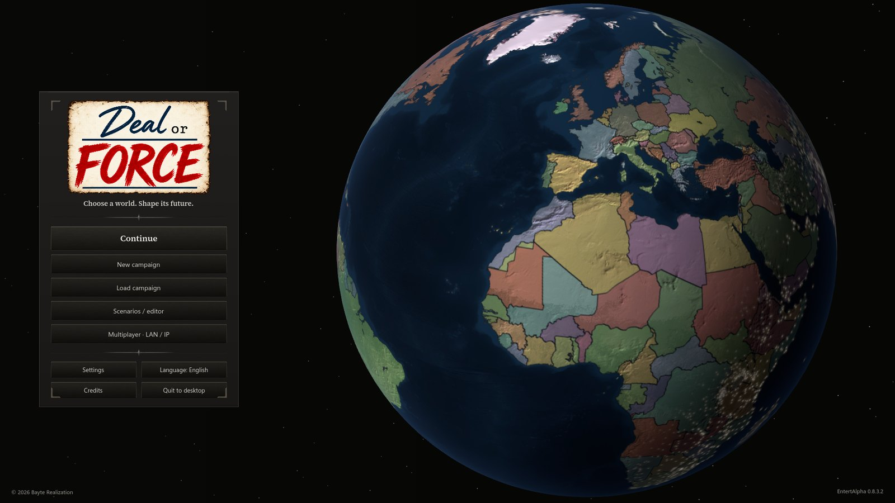

| | |
|---|---|
|  | 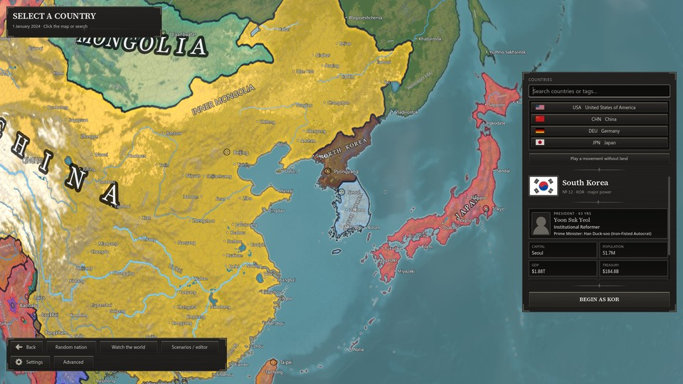 |
| 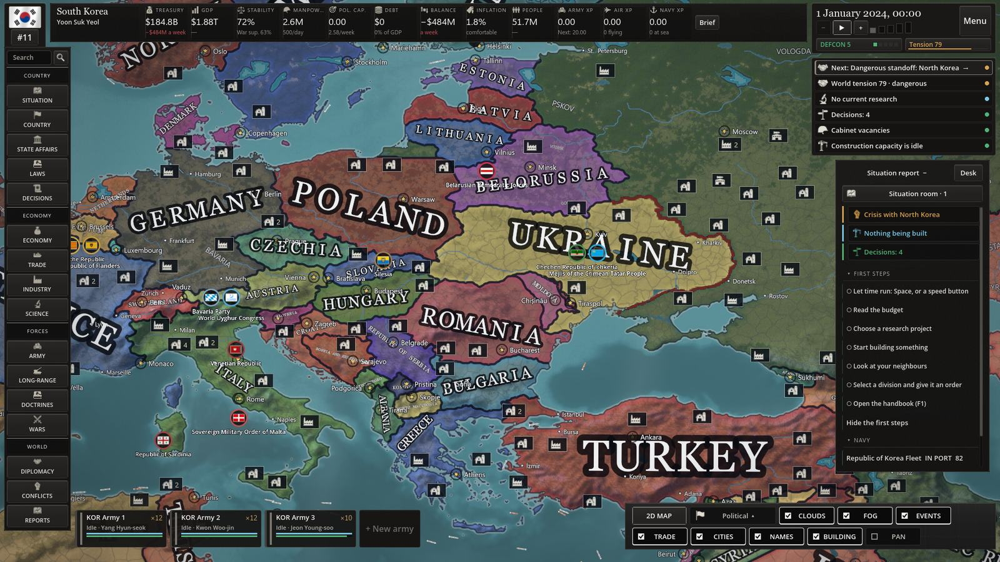 | 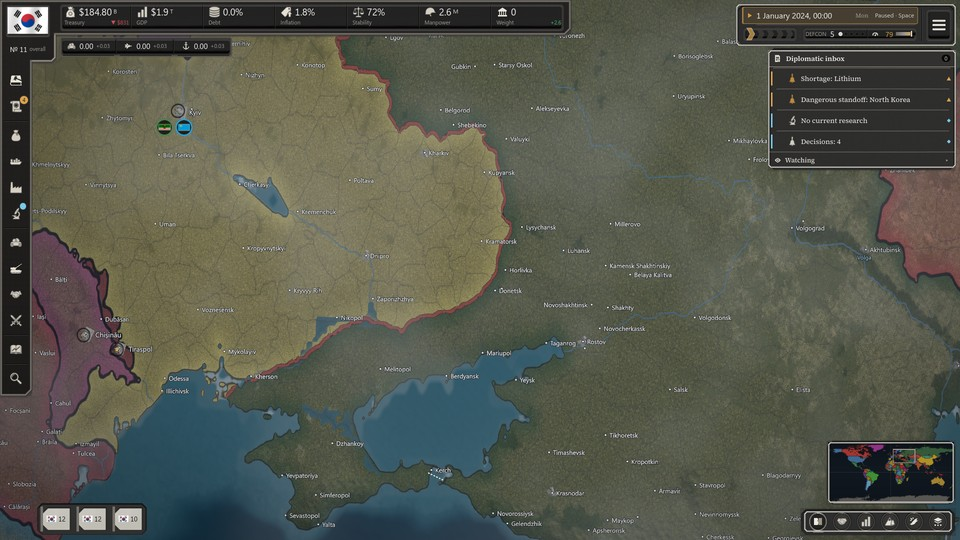 |
| 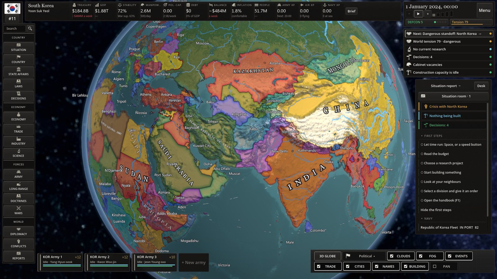 | 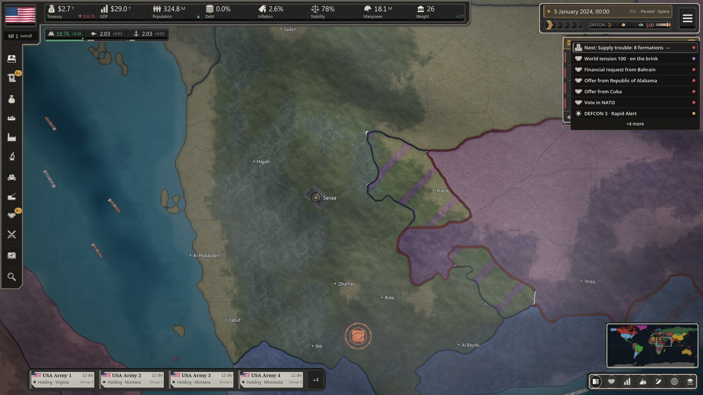 |
| 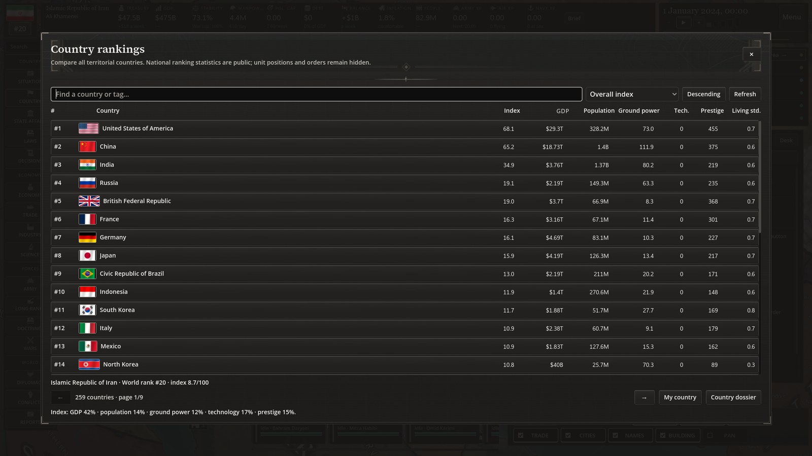 | 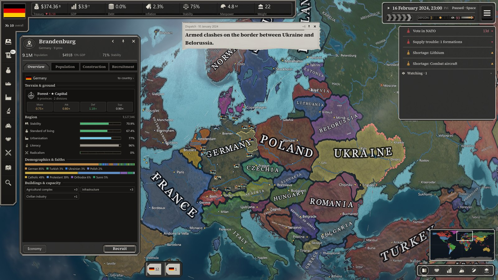 |
| 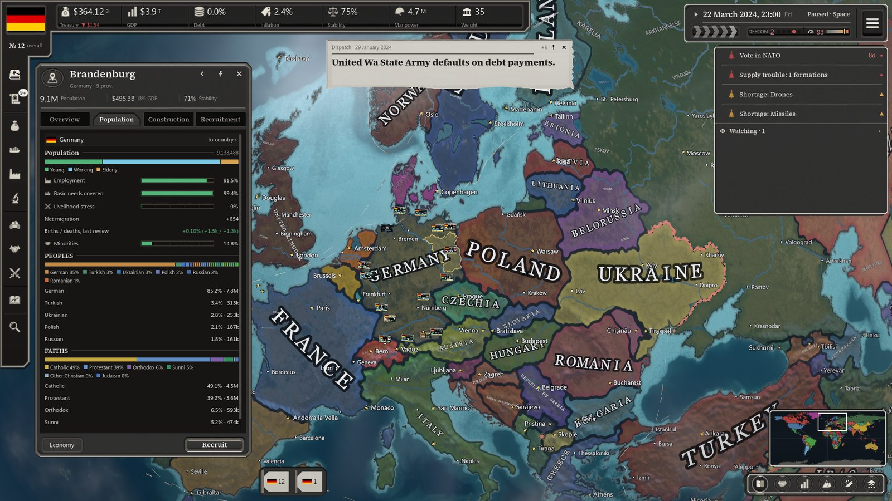 | 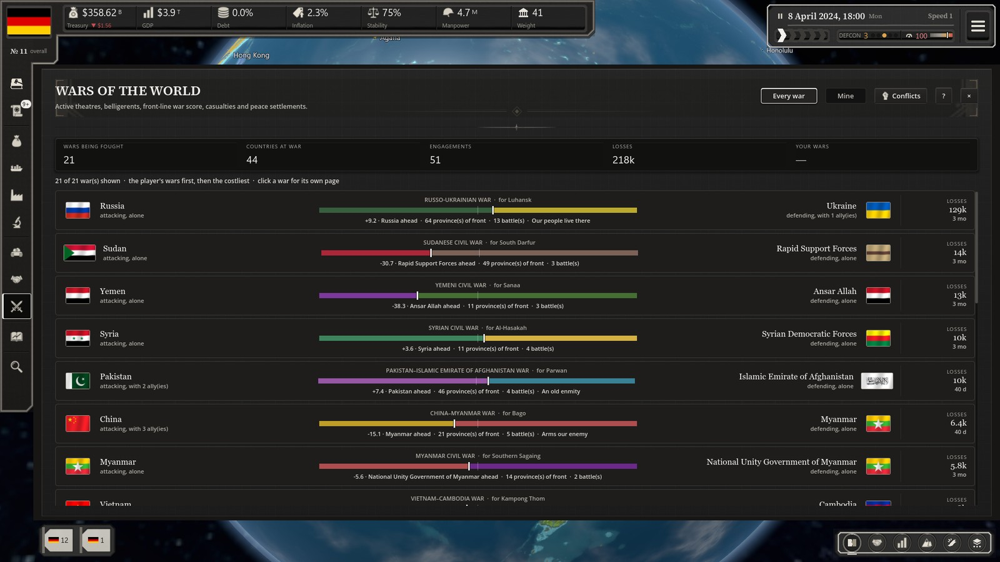 |
| 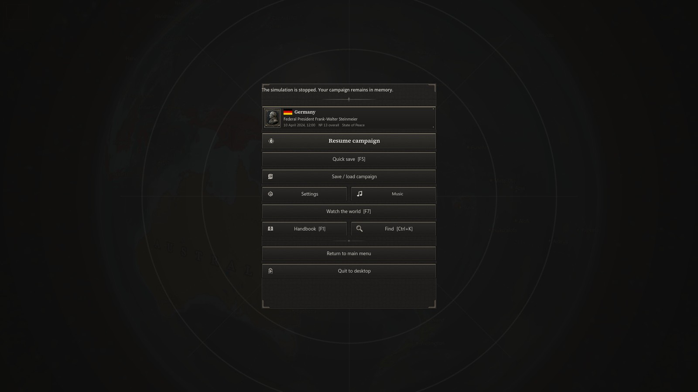 | 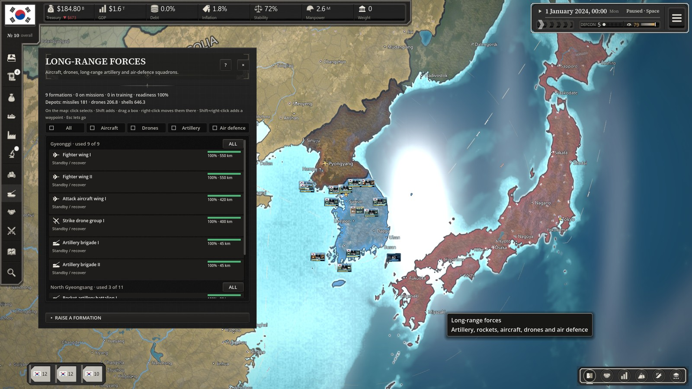 |

## Как сыграть

- **Опубликованные сборки для Windows** (64 бита, английский и русский) доступны на
  [itch.io](https://bayte-realization.itch.io/deal-or-force).
  Распакуйте архив целиком и запустите `Deal or Force Launcher.exe`.
- **Из исходников** — см. [Сборка и запуск](#сборка-и-запуск) ниже.
- [Список изменений PortAlpha 0.8.7.3](docs/CHANGELOG_0.8.7.3_RU.md) охватывает адаптивный
  темп скоростей 1–5, отзывчивое сенсорное управление Android без дрейфа, оптимизацию GLES3/HUD и
  кэши симуляции; [накопительный чейнджлог 0.8.5.3](docs/CHANGELOG_0.8.5.3_RU.md) хранит
  раннюю историю серии 0.8.
- Игру делает один человек — открыто, с помощью ИИ.

Следить за проектом: [YouTube](https://www.youtube.com/@BayteRealization) ·
[X](https://x.com/Bayte_R) · [TikTok](https://www.tiktok.com/@bayte_realization) ·
[Telegram](https://t.me/+39SNXyA92aBmYzhi) · [девлог](https://bayte-realization.itch.io/deal-or-force/devlog)

## Новое в PortAlpha 0.8.7.3

Выпуск собран на **Godot 4.8 Beta 3 .NET** и **.NET 10** (активная ветка публикации **PortAlpha**,
с сохранением исторических `EntertAlpha` и `ReimAlpha`). Подробный разбор изменений — в
[списке изменений PortAlpha 0.8.7.3](docs/CHANGELOG_0.8.7.3_RU.md) и архиве
[0.8.5.3](docs/CHANGELOG_0.8.5.3_RU.md).

- **Адаптивный темп скоростей 1–5, исправления `ProvinceTopology` / `MovementFall` и снижение GC (волны 1–3).**
  `BackgroundSimRunner.AdaptiveStepPacing` включает плавный адаптивный шаг `1 / 2 / 4 / 8 / 24 ч`
  на скоростях 1–5 с ровным выравниванием к полуночи `00:00` на ПК и Android без изменения формата
  сохранений и `CampaignFingerprint`. Кэш `ProvinceTopology._provincesByState` инвалидируется при
  смене границ вместе с живым индексом `ParticipantWarObjective`, исправлено поведение `MovementFall`
  при потере всех провинций, `CampaignIntel.Cache.SyncGate` защищает параллельное чтение,
  `DeterministicParallel.MobileBigLittleCap` держит потоки Android на производительных ядрах, а
  пулы и отказ от лишних строк ИИ сокращают прогон `SimBench 120d` (`17 625 -> 16 393 мс`) и
  аллокации (`2 060 -> 1 699 КБ/день`) в волнах 1–2 при дальнейшей доработке горячих мест в 3-й волне.
- **Мгновенные тапы по регионам на 5-й скорости (`RequestPriorityRead` + `StageOverdue`).** Тапы по
  карте и клики по досье получают приоритетный канал чтения `CampaignAccessGate`, немедленно
  прерывают шаг на ближайшей границе `Campaign.StageOverdue()`, переживают микродрейф камеры через
  `GlobeMapSelectionInput` (`1500 мс` + `CameraMovedMaterially`) и сразу обновляют панели досье
  (`ShellWorkPanelView.Refresh(priority: true)`).
- **Щипок двумя пальцами без увода карты и локализованная панель режимов Android.**
  `TouchGestureMath` отслеживает накопленный размах пальцев (`_pinchRefSpanPx`), убирая боковой
  сдвиг глобуса на 60–120 Гц экранах; `PinchZoomGlobeAt` / `PinchZoomFlatMapAt` масштабируют
  напрямую 1:1 к центру щипка без двойной инерции и отстающего `Lerp`; `ShellTouchModeBarView`
  выводит локализованные кнопки (`Выбор` / `Select`, `Приказ 1×` / `Order 1×`, `Приказ фикс.` /
  `Order Lock`, `Рамка` / `Box`, `Карта` / `Map`) с автоисчезающей подсказкой; а атлас рек 32×32
  (`HydrologySurfaceData.PackRiverCentreline`) и троттлинг 5-й скорости разгружают GLES3 и HUD.
- **Фоновая симуляция, Server GC в релизе и `.dofsave` (0.8.5.3).** Неблокирующий снимок
  `CampaignHudSnapshot` поддерживает отзывчивость карты и панелей (`1,5 мс` бюджет HUD на ПК /
  `1,25 мс` на Android), релизные сборки используют `System.GC.Server` и `TieredPGO`, сохранения
  готовятся вне главного потока в формате **`.dofsave`** (совместимом с `.dfsave` и `.bdfsave`),
  а `RBush`-отсечка и индексированный `ArrayMesh` обеспечивают плавную карту в Forward+ и GLES3
  (`gl_compatibility` на Android).
- **100-летняя цикличная история, динамика держав и новые индикаторы.** Многодесятилетние кампании
  остаются живыми на горизонте столетия: организации распадаются и раскалываются из-за внутреннего
  соперничества и претензий, ИИ-дипломатия реально обличает соперников и переводит истёкшие
  перемирия в `Соперник` или `Нейтралитет`, реваншизм за утраченную родину и повторные войны
  добивают осколки держав, а рост ожиданий населения, экономические/долговые циклы Жюгляра и
  Кондратьева и институциональная склеротизация порождают кризисы, сецессии, распады и эволюцию
  режимов. В досье страны и на экране дипломатии отображаются **отсчёт перемирия**, **претензии на
  утраченную родину (реваншизм)** и текущая **мировая эпоха** (`Многополярный концерт`,
  `Ревизионистская волна`, `Вооружённая разрядка`, `Постимперская турбулентность`), а `MovementUI`
  и экран дипломатии защищены read-lock барьерами `TryEnterRead`.
- **Долгие кампании на 10–30 лет и .NET 10.** Индекс активных войн пропускает завершённые войны,
  мелкие и дублирующиеся когорты объединяются детерминированно, устаревшие поводы мнений, память и
  история сжимаются, ускорены `OrganizationDynamics`, кэширование `FormableNations.CountryIdentity`,
  `Corridors`, `LongRangeMovement` и переговоры ИИ, а библиотеки MIT/Apache-2.0 (`RBush`,
  `DotNext`, `ZeroAlloc.Collections`, `SimdLinq`, `Equativ.RoaringBitmaps`, `Ben.Demystifier`,
  `ZLinq`, `System.IO.Hashing`, `BitFaster.Caching`, `RecyclableMemoryStream`,
  `CommunityToolkit.HighPerformance`, `System.Numerics.Tensors`, `K4os.Compression.LZ4`) режут
  нагрузку на GC. В 10-летнем замере `SimBench` (сид 42) время суток на 10-м году упало с **97,3
  до 78,8 мс/день**, худший пик — с **331 до 156 мс**, сборки Gen0 — на **61,5%** (13 → 5),
  а аллокации на 365-й день — на **35,1%** (4145 → 2690 КБ/день); на сохранении дня 13 358
  `organization life` снизилась с **5,2% до 1,7–1,8%** (`185 → 59 мс` до троттлинга), а суточные
  аллокации — с **5 810 до 5 375 КБ/день**.
- **Сборка для Android (исправление вылета на Exynos / S22 / S21 и графика как на ПК).** Та же
  симуляция с сенсорным управлением и рендером GLES3 (`gl_compatibility`, `msaa_3d=0`, однопоточный
  безопасный режим `thread_model=1`): устранены нативные падения `pthread_mutex_lock` после главного
  меню (безопасный жизненный цикл `RefCounted`/прогрева шейдеров, отложенный прогрев сцен, `DUMMY`
  неиспользуемая 3D-физика), добавлено чтение ОЗУ из `/proc/meminfo`, благодаря чему флагманы с 6+ ГБ
  памяти (`Xclipse 920`, `Mali-G78`, `Adreno`) получают чёткую графику уровня ПК (**`MobileMedium`**
  вместо деградировавшего `MobileLow`), `HeapHardLimitPercent=75`, быстрый 3-уровневый кэш LZ4 без
  PNG и синхронные логи `boot_trace.txt` / `last_crash.txt` в
  `Android/data/com.bayterealization.dealorforce/files/logs/` (и в
  `Документы\Bayte Realization\Deal or Force\logs\` на ПК). Пока технодемо с ручной установкой;
  интерфейс ещё не полностью масштабирован под телефоны.
- **Рельеф, выбор страны и понятные досье.** Армии, города, линии фронта, битвы и подписи стоят
  на высоте земли под ними. Экран выбора страны получил прокручиваемый список из 16/24 строк и
  полную карточку показателей без обрезки, а в настройках экрана выводятся видеокарта, рендер и
  подсказки по диагностике. В досье страны есть кликабельная «Столица» и раскрываемый прогноз
  устойчивости; экономика предупреждает о собираемости налогов; отколовшиеся страны берут 36
  различимых цветов.
- **Новые механики, баланс которых ещё проверяется замерами.** Престиж (0–1000) в рейтинге и
  дипломатии, масштабирование цен событий от ВВП и доходов, системное воссоединение разделённых
  наций, мегапроекты с совместным финансированием, мировые ситуации, национальные амбиции и
  директивы кабинета, методы производства, болезни и бедствия, новые доктрины и Студия моддинга.
- **Штаб ИИ и дипломатическая почта (0.8.3.5).** Любую из 11 отраслей управления можно передать
  своему штабу во вкладке «Штаб (ИИ)» досье своей страны (`Q`) или в «Делах государства» (`E`).
  Входящие письма по всем 9 дипломатическим каналам ждут в строке под датой справа вверху.
- **Исправления карты и меню (0.8.3.4).** Армейские жетоны держат размер при неподвижной камере и
  не мигают сквозь дальнюю сторону глобуса. Закрытие досье региона снимает подсветку с карты, а
  украшения меню остаются под окном, которое их закрывает.
- **Новый интерфейс кампании (0.8.3.2).** Пять матовых фактур (кожа, сланцевый твил, верже,
  чертёжная сетка, архивный лён), которые мод может заменить; карточка «Продолжить» с флагом
  страны в главном меню; стол паузы с правителем, датой и состоянием войн; архив сохранений с
  поиском; вкладка «Общество» в досье страны; широкие карточки фронтов в сводке войн и кнопка
  «Дальнобойные войска» на левой панели.
- **Войны, которые заканчиваются (0.8.3.2).** Полная оккупация или решающий военный счёт теперь
  завершают межгосударственную войну, а не дают ей тянуться. Игрок-победитель получает
  капитуляцию как предложение. Проигравшему игроку её пока могут подписать без него; вернуть ему
  это решение — в плане.
- **Скорость 5 (0.8.3.2).** Тяжёлые этапы симуляции оставляют время на отрисовку и ввод. В замере
  разработки на старте 2024 года скорость 5 выросла с 2,61 до 6,53 игрового дня в секунду, а самый
  длинный кадр симуляции сократился с 661,9 до 27,3 мс. Скорость в самой игре зависит от
  сохранения, настроек и компьютера.

## Об игре

Игра начинается 1 января 2024 года: сотни стран и движений, тысячи регионов и 34 138 провинций.
Исторические данные задают начальные условия; дальше кампанию формируют правила симуляции и события.
Цены складываются из того, что произведено и довезено. Война идёт
по фронту провинция за провинцией, и её надо снабжать. Страна, которая плохо управляет,
теряет регионы — люди в них предпочитают уйти. Играть можно за любую страну на карте.

## Что внутри

Мир — это одна симуляция, а не набор экранов. Шестьдесят три товара делаются по 94 рецептам,
и страны ими торгуют; эмбарго или война обрывают торговлю между двумя сторонами, поэтому
отнимают товар, а не число. Торговля доходит до партнёров по расстоянию, а не плывёт через
проливы: пролив или канал в руках противника закрыт для флотов и конвоев, а враждебный
поставщик ключевого товара замедляет мегапроекты, которым этот товар нужен. Мир заключается на
конференции: каждая провинция, которую вы намерены оставить себе, стоит военного счёта, а экран
объясняет, почему требование не проходит.

Страны зависят друг от друга по-разному. Союз предлагают, и его можно не принять.
Испуганная страна идёт и просит кого-то покрупнее за неё вступиться. Семь видов зависимости
(протекторат, марионетка, сателлит, доминион, особый административный район, клиентское
государство, личная уния) берут свою дань, накладывают свои обязательства в войне и в своём
темпе дрейфуют к желанию уйти. НАТО, ОДКБ и десяток
действующих гарантий стоят на карте с первого утра, потому что так и было.

Войны 2024 года, которые шли не между государствами, стоят на карте с первого дня: Силы
быстрого реагирования в Дарфуре и Хартуме, хуситы в Сане, Идлиб, северо-восток Сирии, восток
Ливии, сопротивление Мьянмы, «Аш-Шабааб», M23 - у каждой своя земля, свои бойцы и та война,
то перемирие или тот мир, что были в то утро. Гражданскую войну ведут две её стороны, а их
друзья вооружают их, а не вступают в неё; фракция, взявшая столицу, берёт государство. Между
войнами у каждой пары стран есть напряжённость, которая растёт от кризиса к вооружённым
столкновениям, и граница, на которой продолжают стрелять, может обернуться короткой
пограничной войной с перемирием в конце. Неустойчивым правительствам грозят военные перевороты.

Регионы отделяются, когда ими никто не управляет. Правительства падают, и на их место
приходят другие. Армии растут, когда у страны есть причина вооружаться, и расходятся по
домам, когда причины нет, а не остаются того размера, с которого начали. Регион под угрозой
сам поднимает ополчение — в своём крупнейшем городе и под его именем.

Война идёт не только на земле, но и в воздухе. Артиллерия, реактивные батареи, авиация,
дроны и ПВО — отдельные соединения: они стоят на базах в регионах, получают задания с
панели рядом с картой, дотягиваются до боёв в своём радиусе и платят за каждый день над
обороняемым фронтом. Технологий 136, и они расходятся от стран, которые их знают, к их
соседям и партнёрам.

Карта читается как атлас: больше семи тысяч городов, подписи которых не налезают друг
на друга, рельеф с тенями «от северо-запада», море с шельфами и дном, а берега и границы
нарисованы теми линиями, с которых их оцифровали, а не лесенкой из текселей, в которой они
хранятся.

Сохранения — это текст, который человек может открыть и поправить, а кампания, начатая с
выбранного сида, строит тот же самый мир.

И все под своим флагом: их около тысячи, и выбираются они по тому, чем страна стала — народ,
идеология, форма правления, отвечает ли она перед кем-то ещё, — а объявляет флаг не что
иное, как имя файла.

## Моддинг

Почти всё — данные. В `game/common` лежат товары, здания, рецепты, идеологии, формы
правления, решения, модификаторы и числа, на которых держится баланс; в `game/history` —
каким мир был в первый день; в `game/localization` — все строки, которые игра показывает, на
английском и на русском, полностью.

Мод кладёт свои файлы рядом с базовыми и выигрывает по порядку загрузки, так что поменять
три числа — это не форкнуть файл:

```
mods/my_mod/
  mod.json
  common/defines/economy.json     только те ключи, которые называет
  events/my_events.json
  localization/russian.json
```

Эффекты — тоже данные, а не код:

```json
"effects": { "treasury_percent": -0.06, "stability": 0.018, "state.radicalism": -0.01 }
```

Голое число прибавляет, `_percent` масштабирует, `_mult` умножает, `_set` присваивает, а
префикс `state.` применяет эффект к каждому региону страны. В `mods/_templates` лежат
рабочие примеры на всех трёх уровнях: JSON, GDScript, скомпилированный C#. Остальное — в
[MODDING_GUIDE_RU](docs/MODDING_GUIDE_RU.md).

## Комплект языков разработки

В проекте сохраняются исходные интеграции **Luau, F#, Nim, Odin, Rust и Kotlin**.
[Руководство и сборка](LanguageKit/GUIDE_RU.md),
[уровни поддержки и правила применения](docs/LANGUAGE_BACKENDS_RU.md).
Все шесть совместно работают в лаборатории Godot 4.8 Beta1 .NET; это не гарантия
всех экспортов/API. Кампания остаётся на C#. Rust — только для редких сложных задач
с измеренной пользой; игрокам и авторам обычных модов не нужны шесть toolchains.

## Сборка и запуск

**Полный разбор — в [docs/GETTING_STARTED_RU.md](docs/GETTING_STARTED_RU.md)**, написанный для
того, кто этот проект никогда не открывал. Коротко:

Нужны **Godot 4.8 Beta 3 именно в сборке .NET** (`Godot.NET.Sdk/4.8.0-beta.3`) — обычная откроет проект и не
найдёт в нём ни одного скрипта — и **.NET SDK 10**.

```bash
git clone https://github.com/Bayte-Realization/deal-or-force.git
cd deal-or-force
dotnet build DealOrForce.csproj
```

Дальше откройте папку в Godot и нажмите **F5**. Игра открывается на `Scenes/MainMenu.tscn` —
меню это отдельная сцена и появляется сразу; мир строится, когда вы попросите кампанию, и это
десять-тридцать секунд.

**Прежде чем верить изменению**, отыграйте кампанию без движка и сверьте её примерно с сотней
инвариантов: что экономика сходится, что два одинаковых мира остаются одинаковыми, что фронт
не перестал тихо быть спорным.

```bash
dotnet run -c Release --project Tools/SimBench/SimBench.csproj -- 730
```

Чтобы собрать то, что другой человек запустит двойным щелчком, — понадобятся шаблоны экспорта
Godot, см. [docs/BUILDING_RU.md](docs/BUILDING_RU.md):

```powershell
powershell -ExecutionPolicy Bypass -File Tools\build.ps1
```

## Если игра не запускается

Игра следит за собственным запуском (`Scripts/Boot/boot_guard.gd`, он работает, даже когда
C#-часть не загрузилась). Если запуск так и не дошёл до меню или меню осталось чёрным, игра сама
переходит на более простой способ отрисовки и перезапускается: Direct3D 12, затем Vulkan, затем
OpenGL, затем OpenGL через Direct3D 11 (ANGLE), который рисует почти на любой видеокарте
последних пятнадцати лет. Если не загрузился код игры (сборку скопировали без папки
`data_DealOrForce_windows_x86_64` или антивирус поместил её часть в карантин), игра пишет об
этом на экране, а не остаётся чёрной.

- Выбор хранится в `%APPDATA%\Godot\app_userdata\Deal or Force\graphics_override.cfg`.
  Удалите его, чтобы вернуться к автоматическому выбору, или выберите способ в *Настройки →
  Экран → Графический движок*.
- Запустить сразу на нужном: `"Deal or Force.exe" --rendering-method gl_compatibility`.
- Лог движка лежит в `%APPDATA%\Godot\app_userdata\Deal or Force\logs\godot.log`, а пошаговый
  след запуска и отчёт о сбое (`boot_trace.txt`, `last_crash.txt`) пишутся в
  `Документы\Bayte Realization\Deal or Force\logs\` на ПК и в
  `Android/data/com.bayterealization.dealorforce/files/logs/` на Android.
- `"Deal or Force.exe" -- --boot-guard-pretend-black` проходит всю цепочку на компьютере, где
  все драйверы работают, — для проверки.

## Документация

Русская версия документа — файл с суффиксом `_RU`, английская — без суффикса; полный указатель —
[docs/README_RU.md](docs/README_RU.md).

| | |
|---|---|
| [Изменения PortAlpha 0.8.7.3](docs/CHANGELOG_0.8.7.3_RU.md) · [0.8.5.3](docs/CHANGELOG_0.8.5.3_RU.md) · [0.8.3.5](docs/CHANGELOG_0.8.3.5_RU.md) · [0.7.2.3](docs/CHANGELOG_0.7.2.3_RU.md) | **список изменений PortAlpha 0.8.7.3 и предыдущие выпуски** |
| [Программа переработки](docs/OVERHAUL_PROGRAMME_2026_11_14_RU.md) | пятнадцать фронтов переработки и что значит «сделано» для каждого |
| [Переработка сделок](docs/DEALS_REWORK_2026_11_14_RU.md) | что не так со сделками сейчас и план по шагам |
| [TUTORIAL_RU](docs/TUTORIAL_RU.md) | **первая кампания — за руку, с примерами** |
| [MODDING_QUICKSTART_RU](docs/MODDING_QUICKSTART_RU.md) | **первый мод за пятнадцать минут** |
| [GETTING_STARTED](docs/GETTING_STARTED_RU.md) | как запустить и собрать |
| [PLAYER_GUIDE_RU](docs/PLAYER_GUIDE_RU.md) | как играть — полный справочник |
| [MODDING_GUIDE_RU](docs/MODDING_GUIDE_RU.md) | как менять — полный справочник |
| [ARCHITECTURE_RU](docs/ARCHITECTURE_RU.md) | как устроено |
| [CSHARP_GUIDE_RU](docs/CSHARP_GUIDE_RU.md) | **C# с нуля на настоящем коде этой игры** |
| [NETWORK_MULTIPLAYER_RU](docs/NETWORK_MULTIPLAYER_RU.md) | локальная сеть и прямой IP |
| [CONFLICTS_AND_FACTIONS_RU](docs/CONFLICTS_AND_FACTIONS_RU.md) | напряжённость, пограничные и прокси-войны, де-факто силы, перевороты |
| [Изменения 8 октября](docs/RELEASE_2026_10_08_RU.md) | что проверено, что изменено и что пока ограничено |
| [План продолжения](docs/DEVELOPMENT_ROADMAP_2026_10_08_RU.md) | связная переработка, сравнение проходов и критерии следующих блоков |
| [Целостность кампании](docs/CAMPAIGN_INTEGRITY_RU.md) | причина переполнения, защита автосейва, сжатие и совместимость |
| [Казна и госдолг](docs/SOVEREIGN_FINANCE_RU.md) | финансовый экран, перенос старого дефицита, просрочки, выпуск и погашение |
| [Международные организации](docs/INTERNATIONAL_ORGANIZATIONS_RU.md) | уставы, взносы, голосование, оборона и собственные организации |
| [Территории и отделение](docs/TERRITORY_AND_RELEASE_RU.md) | родные земли, претензии, независимость по договору, Бир-Тавиль |
| [Домохозяйства](docs/HOUSEHOLD_ECONOMY_RU.md) | рабочие места, нужды, рождения и смерти, границы модели |

## Нашли ошибку?

Нажмите в игре **Настройки → Сообщить о проблеме** (или наберите `report` в консоли). Игра положит
`DealOrForce-report-….zip` в `Документы\Bayte Realization\Deal or Force\reports\`: там сборка,
последние логи, настройки и последнее сохранение. Приложите архив к
[сообщению об ошибке](https://github.com/Bayte-Realization/deal-or-force/issues/new?template=bug_report.yml).
Идеи и вопросы — в [Обсуждения](https://github.com/Bayte-Realization/deal-or-force/discussions).

## Открытые долги

- Растры карты едут в сборке дважды: Godot импортирует все 319 PNG в `.pck`, и они же
  кладутся обычными файлами, потому что часть кода читает их напрямую. Десятки мегабайт,
  которые никому не нужны.
- Интерфейс собирается кодом, но где стоит каждая панель — объявлено в `game/gui/`, а
  палитра в `game/interface/`, так что перекрасить его можно без компилятора.
- В мультиплеере нет миграции хоста: хост отвалился — сессия кончилась.

## Сторонние фреймворки, библиотеки и открытые данные — благодарности создателям

Deal or Force опирается на труд множества талантливых инженеров открытого ПО, создателей языков
программирования, картографов, шрифтовых дизайнеров и авторов Викисклада. Каждый из перечисленных
ниже инструментов и наборов данных делает игру быстрее, точнее и вообще возможной для проекта одного
человека — искреннее спасибо каждому автору и мейнтейнеру! Полные тексты лицензий и уведомлений
хранятся в [`game/THIRD_PARTY_NOTICES.md`](game/THIRD_PARTY_NOTICES.md) и в разделе **«Титры»** самой игры.

| Компонент / Набор данных | Авторы и создатели | Роль в Deal or Force | Лицензия |
|---|---|---|---|
| **Godot Engine 4.8** (`4.8.0-beta.3` .NET) | Хуан Линецки, Ариэль Мансур и контрибьюторы Godot | Отрисовка, 3D-глобус, шейдеры, дерево сцен, среда ПК и Android | MIT |
| **Jolt Physics / Godot Jolt** | Йоррит Рауэ, Микаэль Херманссон (`mihe`) и контрибьюторы | Движок 3D-физики для сборок ПК (`project.godot`) | MIT |
| **.NET 10**, **WPF**, **`System.IO.Hashing`**, **`System.Numerics.Tensors`**, **`RecyclableMemoryStream`** | Microsoft Corporation и .NET Foundation | Среда симуляции, лаунчер, быстрое хэширование `XxHash3`, SIMD-тензоры и пулы потоков | MIT |
| **F# и `FSharp.Core`** (10.1.402) | Дон Сайм, Microsoft и F# Software Foundation | Чистая библиотека правил (`DealOrForce.Rules`) | MIT |
| **`ZLinq`** (1.6.1) и **`SimdLinq`** (1.3.2) | Ёсифуми Каваи (`neuecc`) / Cysharp, Inc. | Запросы к коллекциям без аллокаций и SIMD-агрегации | MIT |
| **`CommunityToolkit.HighPerformance`** (8.4.2) | Серджо Педри, Microsoft и .NET Foundation | Высокоскоростные `Span`, пулы и 2D-буферы | MIT |
| **`DotNext`** (6.13.0) | Роман Сакно (`sakno`), .NET Foundation и контрибьюторы | Низкоаллокационные примитивы и потокобезопасные утилиты | MIT |
| **`BitFaster.Caching`** (2.6.1) | Алекс Пек | Конкурентные LRU-кэши загрузки карты и симуляции | MIT |
| **`ZeroAlloc.Collections`** (2.0.1) | Марсел Розеекранс | Коллекции с пулами и без выделения памяти на горячих путях | MIT |
| **`Equativ.RoaringBitmaps`** (0.1.6) | Авторы Equativ.RoaringBitmaps и формат Roaring Даниэля Лемира | Сжатые битовые множества в индексах и кэшах кампании | Apache-2.0 |
| **`RBush`** (4.0.0) | Дэниел Ньюман / Turning Code (`viceroypenguin`) и Владимир Агафонкин (JS RBush) | Пространственная R-дерево отсечка 7 000+ городов, рек, столиц и подписей | MIT |
| **`K4os.Compression.LZ4`** и **`.Streams`** (1.3.8) | Милош Краевский и Янн Колле (LZ4) | Сверхбыстрое сжатие LZ4 для сохранений и кэшей карты | MIT / BSD-2-Clause |
| **`YamlDotNet`** (18.1.0) | Антуан Обри и контрибьюторы | Разбор YAML-данных для моддинга и инспектора | MIT |
| **`Ben.Demystifier`** (0.4.1) | Бен Адамс и контрибьюторы | Читаемые стеки вызовов в отчётах сбоев `last_crash.txt` | Apache-2.0 |
| **`Tracy Profiler`** и **`Tracy-CSharp`** (0.13.1) | Бартош Таудул (`wolfpld`) и `clibequilibrium` | Опциональное профилирование кадров и зон симуляции (`-p:DofTracy=true`) | BSD-3-Clause / MIT |
| **Roslyn (`Microsoft.CodeAnalysis`)** и пакеты `Tools/*Bench` | Microsoft (`Microsoft.CodeAnalysis`, `Microsoft.Extensions.ObjectPool`, `System.Runtime.CompilerServices.Unsafe`); `genaray` (`Arch`, `Arch.LowLevel`, `ZeroAllocJobScheduler`); Джоэл Мюллер (`Collections.Pooled`); Ульрих Претц (`Friflo.Engine.ECS`); `neuecc`/`aarnott` (`MessagePack`/`MemoryPack`); Олег Степанищев (`ZstdSharp.Port`) | Инструменты аудита кода (`Tools/CodeAudit`) и стенды замеров `Tools/KernelBench` / `Tools/SaveFormatBench` (не поставляются в игре) | MIT / Apache-2.0 / LGPL-3.0-only (dev-only) |
| **Интеграции `LanguageKit/`** | **`godot-rust/gdext`** (Rust), **`Fumohouse/godot-luau-script`** (`voided_etc`, Luau), **`godot-nim/gdext-nim`** (Nim), **`dresswithpockets/odin-godot`** (Odin), **`utopia-rise/godot-jvm`** (Kotlin), **`gilzoide/lua-gdextension`** (Lua), **`libriscv/godot-sandbox`** (Sandbox), **`gdzig/gdzig`** (Zig), **`quaadgras/graphics.gd`** (Go), **`niklas2902/py4godot`** (Python) | Опциональные рецепты нативных и скриптовых адаптеров (`LanguageKit/README.md`) | MIT / Apache-2.0 / MPL-2.0 / BSD-3-Clause |
| **Плагины редактора (`addons/`)** | **Fennara**, **LimboAI** (Сергей Сницарук), **GodotSteam** (Г. П. Гарсия и Крис Райденур), **Dialogue Manager** (Нейтан Хоад), **Ezcha Network** (Ezcha LLC), **Lit** (Шон Депрей), **Scalable Vector Shapes 2D**, **Script-IDE** (Мариус Ханль), **Godot AI**, **GDQuest**, **Ziva Agent** | Локальные плагины разработки, исключённые из Git и релизных сборок (`addons/`) | MIT (и собственные лицензии) |
| **`Source Serif 4`** | Франк Грисхаммер / Adobe Systems Incorporated | Основная книжная антиква интерфейса (`game/fonts/NOTICE.txt`) | SIL OFL-1.1 |
| **ESA GlobCover 2009** | Европейское космическое агентство (ESA) и UCLouvain | Глобальная классификация покрова суши для карты местности | Требуется указание источника |
| **NASA Blue Marble и GEBCO** | Джесси Аллен / NASA Earth Observatory и Британский центр океанографических данных (BODC) | Топографический рельеф суши и батиметрия океанов | Требуется указание источника |
| **Natural Earth** | Участники проекта Natural Earth | Реки, озёра, гидрография, города и исходные данные населения | Общественное достояние |
| **Флаги с Викисклада** | Иллюстраторы Wikimedia Commons (`game/gfx/CREDITS.md`) | Флаги государств, регионов, движений и форм правления | PD / CC0 / CC BY / CC BY-SA |

Локальные плагины редактора в `addons/` (`Fennara`, `LimboAI`, `GodotSteam`, `Dialogue Manager`, `Script-IDE`, `Scalable Vector Shapes 2D` и др.) исключены из Git и сохраняют собственные лицензии.

## Лицензия

**GNU General Public License v3.0 или новее** — полный текст в [`LICENSE`](LICENSE).

    Copyright (C) 2026 Bayte Realization

По-человечески: берите, читайте, меняйте, передавайте дальше — а если передаёте изменённое,
передавайте и исходники под той же лицензией.

`addons/` исключена из репозитория, и у каждого плагина там своя лицензия. Сам Godot под MIT,
что GPL принимает.

Флаги в `game/gfx/flags` взяты с Wikimedia Commons. В [`game/gfx/CREDITS.md`](game/gfx/CREDITS.md)
632 из них перечислены поштучно — с источником, лицензией и автором; национальные флаги,
отрисованные с общественно-достоянных рисунков Википедии, поштучно пока не перечислены, а у
21 варианта источник не записан вовсе — какие именно, сказано в [`game/THIRD_PARTY_NOTICES.md`](game/THIRD_PARTY_NOTICES.md).
Флаг как символ обычно общественное достояние; конкретный его рисунок — не обязательно, ради
этого файл и существует.

Карта собрана из открытых данных: покров земли — ESA GlobCover, рельеф и морское дно —
топография и батиметрия NASA Earth Observatory (данные GEBCO), реки, озёра и города —
Natural Earth. В [`game/THIRD_PARTY_NOTICES.md`](game/THIRD_PARTY_NOTICES.md) у каждого источника указаны условия.

**Собственная графика и звук проекта свободны для повторного использования.** Bayte
Realization разрешает всем использовать, копировать, изменять, распространять и продавать
собственные графические и звуковые материалы проекта, в том числе вне игры, без отдельного
согласования и лицензионных платежей. Указание авторства приветствуется, но не обязательно.
Это включает собственные иконки, текстуры, сгенерированные музыку и звуки, оригинальные
иллюстрации флагов. Отдельной ограничительной лицензии на ассеты больше нет. GPL для кода
не меняется.

Разрешение касается только прав, которыми обладает Bayte Realization. Чужие флаги, шрифты
и исходные данные карты сохраняют условия своих авторов. Источники и пробелы в происхождении
записаны в [уведомлениях о сторонних материалах](docs/THIRD_PARTY_MEDIA.md) и
[кредитах флагов](game/gfx/CREDITS.md). Использование логотипа не означает одобрения автором.

**Steam.** GPLv3 и закрытый Steamworks SDK невозможно удовлетворить одновременно, поэтому на
линковку с ним выдано дополнительное разрешение по §7 GPL — см.
[`LICENSE-EXCEPTIONS.md`](LICENSE-EXCEPTIONS.md). Сегодня от него ничего не зависит:
`godotsteam` лежит только локально, и ни одна строка игры со Steam не разговаривает. Выдано
заранее, потому что такое разрешение требует согласия всех правообладателей, а это проще
всего, пока правообладатель один.
