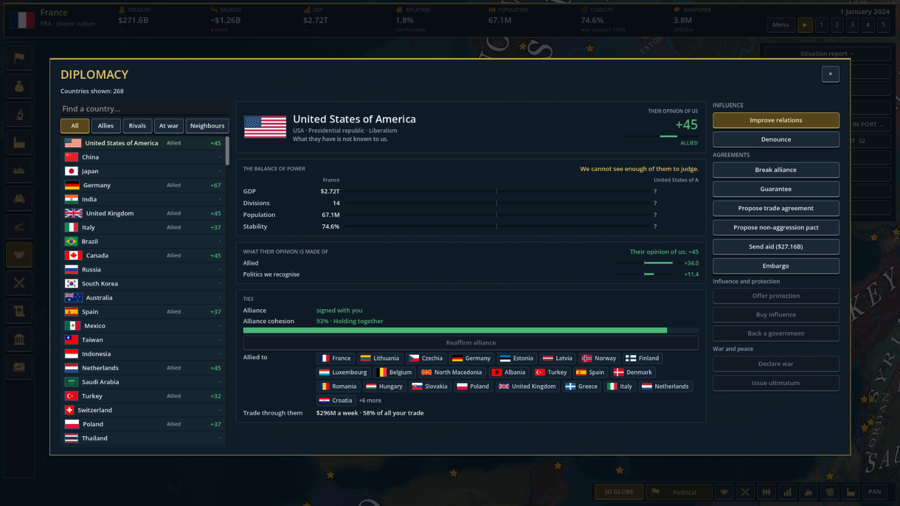
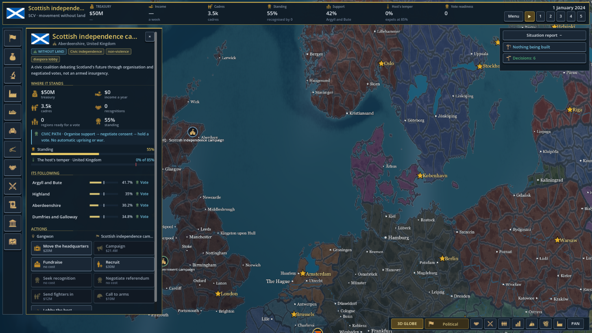

# Рабочая итерация — 5 октября 2026

Проверенный этап по пунктам 98–103 пользовательского плана и пожеланию о более
продолжительных гражданских войнах. Это не закрытие всего списка из 117 пунктов.
Изменения не опубликованы на GitHub; экспортированный билд в этой итерации не собран.

## Союзы перестают быть вечными

Новая система `AllianceMaintenance` раз в семь игровых дней пересматривает прочность
союза: отношения, политические различия, репутацию, торговлю, санкции, общую войну
и конфликтующие обязательства. Неблагополучный союз сначала накапливает напряжение.
При устойчиво низкой прочности ИИ может выйти из него; два игрока не получают
автоматический разрыв. Есть начальный льготный период и задержка повторного договора.

В дипломатии добавлены толстая шкала прочности, объяснение факторов и действие
«Подтвердить союз». Оно даёт прибавку, сбрасывает напряжение и имеет собственный
срок повторного применения. Обновление интерфейса работает на паузе: живая проверка
подтвердила переход 75% → 93% и блокировку повторного нажатия.



## Независимость не обязательно начинается с восстания

Добавлены гражданские движения Шотландии, Уэльса и Квебека; существующее каталонское
движение получило гражданский путь. Это игровые модели, не утверждение, что одно
движение представляет всё население реального региона.

Осведомлённость населения своей исторической территории помогает гражданской
поддержке без обязательного обнищания. Мирный референдум требует большинства
**всех жителей**, легитимности, согласия родительского государства и отсутствия войны.
Игрок-родитель явно разрешает или отзывает согласие; ИИ оценивает сдержанность
правительства и стабильность. Нельзя отобрать последний регион или больше половины
населения родителя. Гражданское движение не поднимает вооружённое восстание.

Успех действительно передаёт территорию, не создаёт бесплатное ополчение или войну,
устанавливает перемирие. В панели показаны доля поддержки, порог 50%, готовность
голосования и причины недоступности действий. Гражданская готовность больше не
называется готовностью восстания в верхней панели.



Названия отделившихся стран учитывают заданную культурную родину и существующие
территориальные государства. Диаспора вне родины получает местное название, а не
дублирует национальное государство. Добавлены модифицируемые привязки родины
шотландцев, валлийцев, квебекцев, каталонцев и басков.

## Флаги

Исторический бургундский крест больше не универсальный флаг традиционалистов:
он ограничен испанской и баскской культурными привязками. Ограничения задаются
данными, мод может заменить их, в том числе снять пустым списком.

Добавлены 12 культурных привязок к уже существующим PNG для азиатских, африканских
и тихоокеанских культур. Это расширение покрытия запасных флагов, **не** 12 заново
нарисованных исторических флагов. Новые культуры и религии в этом этапе не добавлялись.

## Продолжительность и эскалация гражданских войн

Новые войны с причиной отделения или восстания помечаются гражданскими. Для них
ранние переговоры ИИ заблокированы на 540 дней, даже при высоком военном счёте.
Полное поражение и капитуляция по-прежнему могут закончить войну раньше: не нужно
поддерживать конфликт с уже исчезнувшей стороной. Игрока система не лишает управления
переговорами. Ранее созданные войны не получают новую метку задним числом.

При действующем фронте и потерях каждые 90 дней возможна ограниченная мобилизация
резервов ИИ, максимум три стадии. Каждая сторона поднимает не больше одного
формирования за стадию при наличии собственной контролируемой территории, людей
и денег. Есть потолок ополчений, зависимый от населения; бесплатной бесконечной
генерации нет. Ресурсы игрока автоматически не расходуются. Сводка войны показывает
гражданский характер и стадию эскалации.

Пример переопределения баланса в `common/defines/*.json`:

```json
{
  "DynamicAlliances": true,
  "AllianceReviewDays": 7,
  "AllianceGraceDays": 90,
  "AllianceRuptureDays": 56,
  "AllianceReaffirmDays": 90,
  "CivilWarNegotiationDays": 540,
  "CivilWarEscalationDays": 90,
  "CivilWarEscalationStages": 3,
  "CivilWarReserveFormations": 6,
  "CivilWarReserveCost": 0.02,
  "Features": { "militia": true }
}
```

Стоимость 0.02 выражена в единицах казны игры — $20 млн. Эти же схемы каталогов
доступны в YAML. `militia: false` запрещает новые ополчения и гражданские резервы,
но не удаляет уже существующие армии.

Это не обещание минимальной длительности любой войны и не принудительное повышение
числа жертв. Средняя длительность китайских гражданских войн пока **не измерена**
серией длинных прогонов. Следующий балансный этап — сопоставить продолжительность,
капитуляции, потери и нагрузку, затем решать, нужны ли дополнительные внешние
спонсоры, снабжение или фазы истощения.

## Языки и моддинг

Существующие GDScript-моды сохранены. F#-DLL теперь загружаются в отдельный
`AssemblyLoadContext` с разрешением зависимостей конкретного мода. Пример и три хука
проверены; произвольные зависимости в экспортированной игре требуют отдельной проверки.

Go, Rust и Luau получили исполняемый worker-контракт JSON v1. Все три примера
скомпилированы и запущены через игровой хост в регрессионных проверках. Luau использует
официальные Compiler и VM, а не замену обычным Lua. Rust установлен изолированно
в `build/`, системный PATH не изменялся. Шаблоны выключены по умолчанию.

Первый API намеренно мал: включение механик, улучшение отношений, подтверждение
союза. Хост проверяет весь пакет до постановки команд в очередь, ограничивает
ввод/вывод, число команд, время и завершает зависший процесс. Ошибочный worker
отключается. Поддержка только для одиночной игры; процесс на каждый хук не хранит
постоянное состояние. Ожидание синхронное и может задержать игровой тик до таймаута.

Это **не** полная интеграция пяти языков в редактор Godot. GDExtension и
ScriptLanguageExtension — отдельная задача, форк движка не создавался. Нативные
workers и .NET/GDScript-моды являются доверенным кодом с правами пользователя,
а не OS-песочницей. Luau-скрипт ограничен отдельной VM без файловых и сетевых API.

Подробности: [языки и GDExtension](LANGUAGE_BACKENDS_RU.md),
[worker-протокол и сборка примеров](WORKER_MODS_RU.md),
[JSON/YAML и ограничения](YAML_MODDING_RU.md).

## `.import` и `mod_api_smoke`

`.import` рядом с ресурсами сохранены: это настройки импорта и связь исходного
ресурса с импортированным представлением, а не мусор. Они отличаются от
пересоздаваемого кэша `.godot/`. Массовое удаление настроек не выполнялось.

`mods/mod_api_smoke` оказался тремя пустыми каталогами без манифеста и файлов.
После проверки точных путей удалены только эти пустые каталоги, без рекурсивного
удаления. Потерянных данных нет, каталоги можно создать снова. Настоящие тестовые
проекты в `Tools/` сохранены.

## Проверки и оставшаяся работа

- Полная регрессия `Tools/FormableTests`: **1084 успешные проверки**, exit 0,
  включая динамические союзы, территориальные референдумы, оплату резервов,
  сериализацию, флаги и реальные Go/Rust/Luau-процессы. Это число проверок,
  не 1084 независимых тестовых сценария.
- `Tools/ManagedModTests`: три проверки F#/.NET прошли.
- Сборка C# успешна. Проверка проекта Fennara: 479 файлов, ноль ошибок;
  два существовавших предупреждения целочисленного деления в `boot_guard.gd`.
- Живые проверки панели движения и подтверждения союза на паузе завершены;
  последняя тестовая игровая сессия остановлена, редактор пользователя оставлен открытым.
- `git diff --check` пройден. Локальные компиляторы и бинарники находятся в
  игнорируемом `build/`, не публиковались.

Остались полный аудит остальных пунктов плана, длительные балансные прогоны Китая,
новый оригинальный флаговый арт, расширение культур/религий, более широкая переработка
интерфейса, экспортная проверка зависимостей F# и дальнейшее расширение API.
Сетевая поддержка workers и полноценные языковые адаптеры Godot не заявляются.

## Следующий этап того же дня: нативный Luau и Godot 4.8

Описанные выше языковые ограничения относятся к первому этапу. Теперь дополнительно
установлен **экспериментальный Luau ScriptLanguageExtension** через GDExtension:
ресурсы `.lua`, независимые экземпляры и кампанийные хуки. Добавлены воспроизводимый
установщик, зафиксированный upstream, патч возврата `Callable.Call`, read-only мост
из десяти функций ModApi и отключение ошибочного экземпляра без ежедневного спама.
Шаблон `luau_engine` по умолчанию выключен; включённый временный тестовый мод
перенесён из `mods/` в `Tools/LanguageAdapters/fixtures/campaign_mod` без удаления.

Регистрация, типизированные методы, состояние и native Callable прошли четыре
проверки отдельного процесса, exit 0. В живой кампании прошли load/campaign/day
хуки и восстановление авиации. Штатное завершение с C#-мостом — exit 0. Отдельный
намеренно отрицательный сценарий отключил мод на втором daily-hook и продолжил
кампанию без повторов; после завершающей очистки Dictionary проверка повторена
до дня 51, штатный exit 0. Пользовательские сейвы не менялись, редактор не закрывался.

Повторно прошли FormableTests (exit 0, в том числе реальные workers) и три проверки
ManagedModTests/F#. Итоговая C#-сборка успешна. Общий диагностический скан теперь
видит также вложенные примеры godot-cpp в игнорируемом `build/`: он сообщает две
ошибки в `extern/godot-cpp/test/project/example.gd` и `main.gd`, которым нужен
собственный test project. Это не сцены игры; `build/.gdignore` уже присутствует.
Два предупреждения `boot_guard.gd` остались прежними. Проверка нашего standalone
GDScript выполняется отдельно, не скрывая эти результаты общего скана.

Есть обнаруженное ограничение upstream: переданные в Luau замыкания GDScript
вызывали падение при shutdown; наш C#-мост их не использует. Не обещается
совместимость произвольных межъязыковых callbacks, export/release, горячей
перезагрузки, всех свойств/сигналов или сетевой игры. Rust/Go всё ещё workers,
F# — .NET DLL; полноценные исходные адаптеры этих языков остаются отдельной задачей.
Подробности и команды: [Luau-адаптер](LUAU_ADAPTER_RU.md).

Основной проект оставлен на Godot 4.7.2 / net8.0. Godot 4.8 dev7 от 29 сентября
2026 ещё pre-release и повышает минимум .NET до 10. Перенос без отдельного
проверочного проекта не выполнялся. Бинарник не публиковался на GitHub; архив
экспортной игры в этом этапе не собирался.
