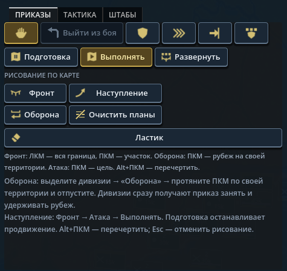
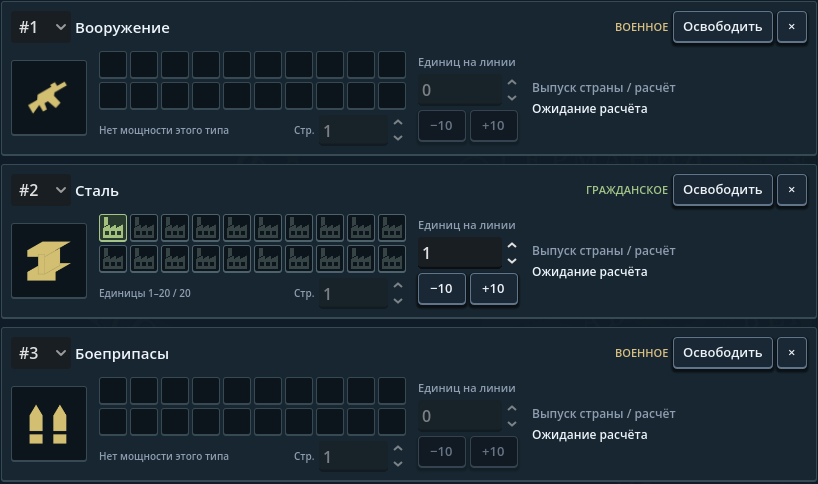
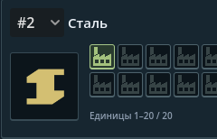

# Иконки и читаемость команд — 4 октября 2026

## Что изменено

- Переработаны 16 армейских пиктограмм. Новые отдельные значки: выход из боя,
  очистка всех связанных планов, осторожная и агрессивная тактики. Ластик и
  очистка больше не используют одну картинку. Это графика существующих команд,
  не новые боевые механики.
- Добавлены 14 отсутствовавших иконок стратегических товаров, включая
  боеприпасы. Вооружение получило отдельный силуэт; дополнительно подготовлен
  значок военного снабжения для дальнейшего использования/модов.
- Исправлен поиск товарных иконок: имя строится по стабильному ID каталога,
  а не по числу динамического enum. Сейчас PNG есть у всех 34 базовых товаров.
- Армейские кнопки резервируют место под текст **и** иконку. Ряды приказов,
  выполнения и тактик могут переноситься; инструменты рисования занимают две
  колонки. Размер пересчитывается при обновлении панели после смены языка/шрифта.
- Добавлен перевод `Low` → «Низкий». Заголовки торговых карточек вынесены над
  селекторами: длинное название страны не выдавливает подпись, статус не
  обрезается фиксированными 120 пикселями.

## PNG и моддинг

Все новые игровые изображения — самостоятельные прозрачные **96 × 96 PNG** в
`game/gfx/interface/icons`. Например, мод заменяет
`gfx/interface/icons/icon_plan_clear.png` или
`gfx/interface/icons/icon_good_ammunition.png` отдельно. Товар мода
`TestCrystalFuel` использует `icon_good_testcrystalfuel.png`.

После замечания о стиле 32 новые пиктограммы заменены плоскими монохромными
силуэтами: 16 команд, 15 товаров и дополнительное снабжение. Белая графика
окрашивается интерфейсом; армейские кнопки используют цвета темы для обычного,
наведённого, нажатого и отключённого состояния. Никаких объёмных обводок,
металлических бликов и декоративных рамок в PNG нет.

Текущие оригинальные формы описаны в `Assets/ArtSource/Icons/minimal-icons.json`,
не вырезаны из EU/HOI. Экспортёр рисует геометрию в 384 × 384 и уменьшает до
96 × 96. Моддеру генератор не нужен: можно просто заменить отдельный PNG.
Команды воспроизведения и проверки: [ArtSource README](../Assets/ArtSource/Icons/README.md).
Старые сгенерированные листы сохранены только как исторический источник и не
создают текущие PNG. `.gdignore` исключает рабочую графику из ресурсов Godot.

Реальный игровой фрагмент, без перерисовки интерфейса:

Товары: [снимок рынка](screenshots/minimal-goods-market-2026-10-04.png).

## Дополнение: золотистые товары в производстве

Белые силуэты PNG — нейтральная основа для окраски темой. В карточках
производства эта окраска отсутствовала; теперь они используют `text.accent_dim`
(`#d3bf72` в базовой теме). Тот же цвет заново применяется
при обновлении производства, рынка и выбранного товара торговой инструкции,
в том числе после Ctrl+Shift+R.

Переработаны пропорции двух PNG: сталь стала узнаваемой двутавровой балкой,
вооружение — единым силуэтом винтовки с более согласованными прикладом,
стволом и магазином. Размер 96 × 96, прозрачность, отдельные файлы и геометрические
исходники сохранены. Остальные 30 PNG текущего набора не изменились.

Фрагмент живой игры в исходном масштабе (818 × 484, вырезка из 1920 × 1080):

Проверка этого дополнения:

- `FormableTests --icons-only` и `check-minimal-icons.ps1` проходят.
- Диагностика проекта: 475 файлов, ноль ошибок; два прежних предупреждения
  `boot_guard.gd` о целочисленном делении. Игровая Debug-сборка успешна.
- В новой кампании Польши реальные кнопки открыли производство и добавили линии
  вооружения, стали и боеприпасов. Все три текстуры загружены и окрашены золотистым.
- Для проверки темы временно изменён только `text.accent_dim` на `#ad8ee8`:
  Ctrl+Shift+R перекрасила все три значка. Возвращение `#d3bf72` и повторная
  перезагрузка вернули золотистый цвет. Изменение палитры в репозиторий не входит.
- Проверка смены цвета выполнена для производства; изменённые торговые места
  проверены по коду и сборкой, отдельный сценарий смены цвета торговли не запускался.

Расчёты производства и экономический баланс этим исправлением не менялись.
Снимки документации исключены из импорта/экспорта Godot через `.gdignore`.

### Уточнение формы стали

После замечания о «загнутой» нижней полке балка заменена одним цельным
геометрическим контуром. Верхняя и нижняя полки имеют одинаковую толщину
и согласованный сдвиг перспективы; наложения отдельных граней больше не
создают внутренних полупрозрачных швов. Цвет темы и формат прозрачного PNG
96 × 96 не менялись; остальные 31 PNG набора побайтно сохранены.

`check-minimal-icons.ps1`: все 32 PNG проходят. Выполнен штатный импорт Godot,
затем повторная живая проверка производства; значок осмотрен в обычном
интерфейсе после закрытия консоли. Сборка и проба успешны, остаются только
два прежних предупреждения `boot_guard.gd`.

Последняя форма стали (вырезка из игры в исходном масштабе):

## Дополнение по пункту 114

Все 48 различных названий базовых флотов 2024 теперь имеют русский перевод.
15 существовавших ключей вынесены из общего `30_content.json` в отдельные
`141_fleet_names.json`; остальные добавлены. Локализация меняет отображение, а
не данные кампании. Английские и пользовательские собственные имена сохранены.
Это не завершение локализации всех дивизий, армий и возможных сценариев модов.

## Проверено

- `FormableTests --icons-only`: роли и наследование модов, 16 армейских спрайтов,
  все 34 товара, 50 файлов с PNG-сигнатурой, ID боеприпасов и имя нового товара мода.
- `FormableTests --army-localization-only`: 34 русских ключа и английский fallback.
- `FormableTests --fleet-localization-only`: все 48 базовых названий, английский
  вывод и сохранение произвольного имени игрока.
- `check-minimal-icons.ps1`: все 32 PNG декодируются, имеют прозрачные поля,
  ненулевые монохромные силуэты и не обрезаны по краям. `--icons-only` также
  проверяет геометрию и RGBA-размер всех новых пиктограмм.
- Повторный экспорт в отдельную временную папку: все 32 PNG побайтно совпадают
  с игровыми файлами на проверенной Windows-среде.
- После стилистической переработки повторно осмотрены команды, тактики и рынок
  в живой игре. Первая проба обнаружила старый кэш импортированных текстур;
  выполнен штатный импорт Godot и повторный запуск, финальные снимки показывают
  новые силуэты. Не проверялись все возможные модифицированные темы.
- Русская сводка показывает четыре переведённых флота России. Повторная
  Ctrl+Shift+R: «No loading errors», интерфейс обновлён за 16 мс на этой машине.
- `SimBench --integrity-only`: все пять групп целостности проходят.
- Живой Godot.NET: реальный выбор стека дивизий, вкладки приказов/тактик,
  открытие торговли и просмотр стратегических товаров. Все 34 товарные текстуры
  загружены. После исправления торговых заголовков связанных layout-предупреждений
  в повторной проверке нет. Ctrl+Shift+R обновляет интерфейс без ошибок загрузки.
- Панель приказов осмотрена при 1920 × 1080 и в окне 1280 × 720. Во втором случае
  Godot сохраняет логический viewport 1920 × 1080 и масштабирует его; это не тест
  всех DPI, пользовательских шрифтов и модифицированных макетов.
- Последняя игровая Debug-сборка успешна; два старых предупреждения
  `boot_guard.gd` о целочисленном делении остаются. В пробе изменения окна было
  предупреждение приведения enum в тестовом скрипте, не ошибка игрового кода.

Пункт 115 пользовательского списка закрыт в части товарных/боеприпасных иконок.
Оптимизация всей игры, длительное поведение ИИ и расчёты ВВП этим изменением не
объявляются завершёнными. Новый бинарный архив/публичный релиз не создавался.
