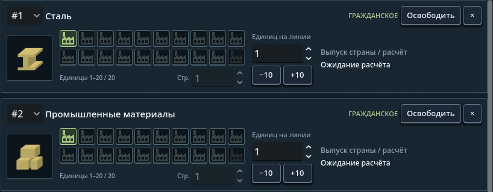
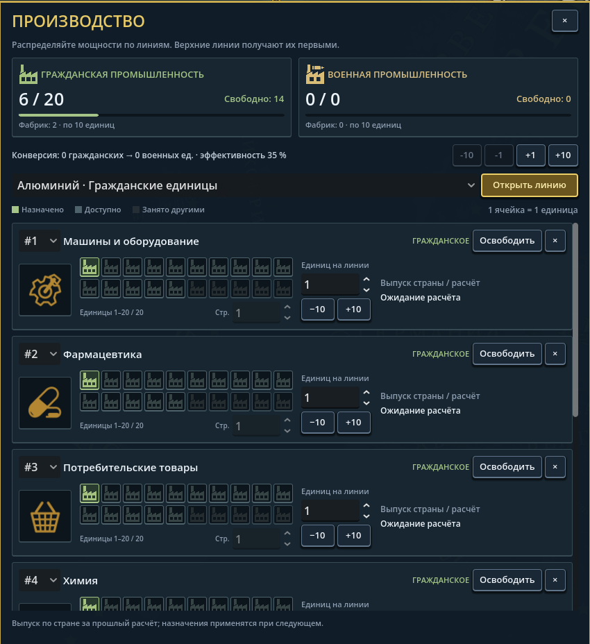
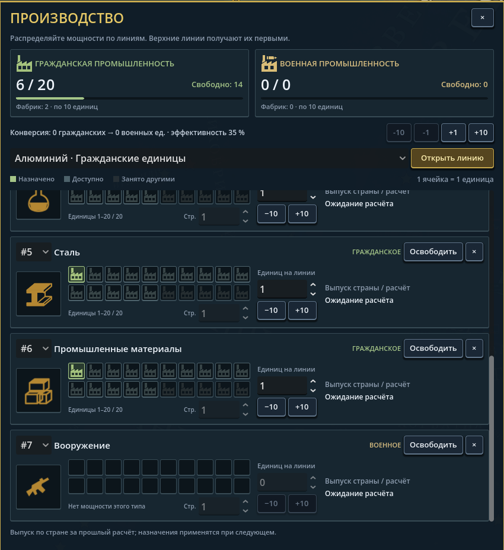
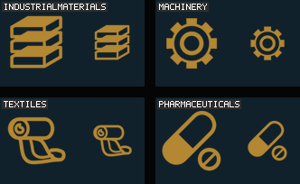
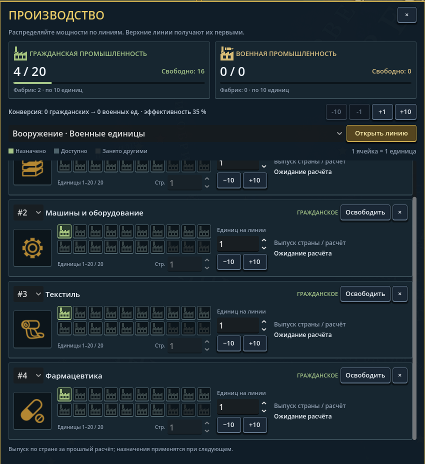

# Иконки и читаемость команд — 4 октября 2026

## Последняя версия: золотые файлы и разные товары

По последнему замечанию все **33** PNG набора теперь золотые в самих файлах
(`#e7bd69`), не белые маски. Сталь получила простые объёмные грани и недостающую
нижнюю поверхность верхней полки. «Промышленные материалы» используют стопку
строительных блоков: две разные товарные роли больше не повторяют двутавр.
Минималистичные силуэты, прозрачность и формат 96 × 96 сохранены.

Чтобы золото не окрашивалось повторно, `minimal_palette.json` сообщает каталогу
исходный `source_colour`; производство, торговля и армейские кнопки компенсируют
его перед применением цвета темы. Белые PNG модов по-прежнему поддерживаются.
Обычная замена текстуры сбрасывает унаследованный исходный цвет; золотой мод
может указать собственный `source_colour`. Геометрия и экспортёр остаются
редактируемыми, генератор изображений для воспроизведения не требуется.

Последующая история ниже описывает прежние версии, включая уже заменённые белые
маски и более ранний контур балки; эти разделы не задают текущую палитру.

Проверки последней версии:

- Все 33 PNG проходят проверку размера, прозрачных краёв, заполнения и золотой
  палитры. Каталог проверяет исходный цвет, частичные накладки, обычную подмену
  PNG и отдельные изображения стали/материалов.
- Полные `FormableTests`, `ResourceChainTests` и `SimBench --integrity-only`
  завершились успешно. Отдельный `--production-only`: 27 проверок.
- В живой игре осмотрены производство, [торговля](screenshots/gold-steel-trade-2026-10-04.png)
  и [приказы](screenshots/gold-army-commands-2026-10-04.png). Проверены четыре
  цветовых состояния всех 16 команд. Производство открывалось обычными кликами;
  для переходов между модальными панелями использовались их реальные обработчики
  кнопок. Дивизия выбрана кликом по карте. Это не отдельная регрессия всех команд.
- Ctrl+Shift+R: оформление перечитано без ошибок загрузки. Последняя C# Debug-
  сборка успешна; скан 475 файлов: 0 ошибок, два прежних предупреждения `boot_guard.gd`.
- Новый товар мода без PNG теперь сохраняет читаемую строку и управление линией,
  не выдавая ошибки загрузки на каждом обновлении. В повторной чистой пробе ему
  назначены две единицы. Это допустимое отсутствие необязательной картинки,
  не создание автоматической уникальной иконки для произвольного товара.

Во время разработки исправлены ошибки самих проб: неверная надпись кнопки,
попытка принять её путь за объект и обращение Fennara к пути уже удалённого узла
после перехода в меню. В финальной сессии этих ошибок нет; аддон не изменялся.

## Что изменено

- Переработаны 16 армейских пиктограмм. Новые отдельные значки: выход из боя,
  очистка всех связанных планов, осторожная и агрессивная тактики. Ластик и
  очистка больше не используют одну картинку. Это графика существующих команд,
  не новые боевые механики.
- Добавлены 14 отсутствовавших иконок стратегических товаров, включая
  боеприпасы. Вооружение получило отдельный силуэт; дополнительно подготовлен
  значок военного снабжения для дальнейшего использования/модов.
- Исправлен поиск товарных иконок: имя строится по стабильному ID каталога,
  а не по числу динамического enum. Сейчас PNG есть у всех 34 базовых товаров.
- Армейские кнопки резервируют место под текст **и** иконку. Ряды приказов,
  выполнения и тактик могут переноситься; инструменты рисования занимают две
  колонки. Размер пересчитывается при обновлении панели после смены языка/шрифта.
- Добавлен перевод `Low` → «Низкий». Заголовки торговых карточек вынесены над
  селекторами: длинное название страны не выдавливает подпись, статус не
  обрезается фиксированными 120 пикселями.

## PNG и моддинг

Все новые игровые изображения — самостоятельные прозрачные **96 × 96 PNG** в
`game/gfx/interface/icons`. Например, мод заменяет
`gfx/interface/icons/icon_plan_clear.png` или
`gfx/interface/icons/icon_good_ammunition.png` отдельно. Товар мода
`TestCrystalFuel` использует `icon_good_testcrystalfuel.png`.

После замечания о стиле 32 новые пиктограммы заменены плоскими монохромными
силуэтами: 16 команд, 15 товаров и дополнительное снабжение. Белая графика
окрашивается интерфейсом; армейские кнопки используют цвета темы для обычного,
наведённого, нажатого и отключённого состояния. Никаких объёмных обводок,
металлических бликов и декоративных рамок в PNG нет.

Текущие оригинальные формы описаны в `Tools/IconCompiler/Source/Icons/minimal-icons.json`,
не вырезаны из EU/HOI. Экспортёр рисует геометрию в 384 × 384 и уменьшает до
96 × 96. Моддеру генератор не нужен: можно просто заменить отдельный PNG.
Команды воспроизведения и проверки: [README исходников](../Tools/IconCompiler/Source/Icons/README.md).
Старые сгенерированные листы сохранены только как исторический источник и не
создают текущие PNG. `.gdignore` исключает рабочую графику из ресурсов Godot.

Реальный игровой фрагмент, без перерисовки интерфейса:

Товары: [снимок рынка](screenshots/minimal-goods-market-2026-10-04.png).

## Дополнение: золотистые товары в производстве

Белые силуэты PNG — нейтральная основа для окраски темой. В карточках
производства эта окраска отсутствовала; теперь они используют `text.accent_dim`
(`#d3bf72` в базовой теме). Тот же цвет заново применяется
при обновлении производства, рынка и выбранного товара торговой инструкции,
в том числе после Ctrl+Shift+R.

Переработаны пропорции двух PNG: сталь стала узнаваемой двутавровой балкой,
вооружение — единым силуэтом винтовки с более согласованными прикладом,
стволом и магазином. Размер 96 × 96, прозрачность, отдельные файлы и геометрические
исходники сохранены. Остальные 30 PNG текущего набора не изменились.

Фрагмент живой игры в исходном масштабе (818 × 484, вырезка из 1920 × 1080):

Проверка этого дополнения:

- `FormableTests --icons-only` и `check-minimal-icons.ps1` проходят.
- Диагностика проекта: 475 файлов, ноль ошибок; два прежних предупреждения
  `boot_guard.gd` о целочисленном делении. Игровая Debug-сборка успешна.
- В новой кампании Польши реальные кнопки открыли производство и добавили линии
  вооружения, стали и боеприпасов. Все три текстуры загружены и окрашены золотистым.
- Для проверки темы временно изменён только `text.accent_dim` на `#ad8ee8`:
  Ctrl+Shift+R перекрасила все три значка. Возвращение `#d3bf72` и повторная
  перезагрузка вернули золотистый цвет. Изменение палитры в репозиторий не входит.
- Проверка смены цвета выполнена для производства; изменённые торговые места
  проверены по коду и сборкой, отдельный сценарий смены цвета торговли не запускался.

Расчёты производства и экономический баланс этим исправлением не менялись.
Снимки документации исключены из импорта/экспорта Godot через `.gdignore`.

### Уточнение формы стали

После замечания о «загнутой» нижней полке балка заменена одним цельным
геометрическим контуром. Верхняя и нижняя полки имеют одинаковую толщину
и согласованный сдвиг перспективы; наложения отдельных граней больше не
создают внутренних полупрозрачных швов. Цвет темы и формат прозрачного PNG
96 × 96 не менялись; остальные 31 PNG набора побайтно сохранены.

`check-minimal-icons.ps1`: все 32 PNG проходят. Выполнен штатный импорт Godot,
затем повторная живая проверка производства; значок осмотрен в обычном
интерфейсе после закрытия консоли. Сборка и проба успешны, остаются только
два прежних предупреждения `boot_guard.gd`.

Последняя форма стали (вырезка из игры в исходном масштабе):

## Дополнение по пункту 114

Все 48 различных названий базовых флотов 2024 теперь имеют русский перевод.
15 существовавших ключей вынесены из общего `30_content.json` в отдельные
`141_fleet_names.json`; остальные добавлены. Локализация меняет отображение, а
не данные кампании. Английские и пользовательские собственные имена сохранены.
Это не завершение локализации всех дивизий, армий и возможных сценариев модов.

## Проверено

- `FormableTests --icons-only`: роли и наследование модов, 16 армейских спрайтов,
  все 34 товара, 50 файлов с PNG-сигнатурой, ID боеприпасов и имя нового товара мода.
- `FormableTests --army-localization-only`: 34 русских ключа и английский fallback.
- `FormableTests --fleet-localization-only`: все 48 базовых названий, английский
  вывод и сохранение произвольного имени игрока.
- `check-minimal-icons.ps1`: все 32 PNG декодируются, имеют прозрачные поля,
  ненулевые монохромные силуэты и не обрезаны по краям. `--icons-only` также
  проверяет геометрию и RGBA-размер всех новых пиктограмм.
- Повторный экспорт в отдельную временную папку: все 32 PNG побайтно совпадают
  с игровыми файлами на проверенной Windows-среде.
- После стилистической переработки повторно осмотрены команды, тактики и рынок
  в живой игре. Первая проба обнаружила старый кэш импортированных текстур;
  выполнен штатный импорт Godot и повторный запуск, финальные снимки показывают
  новые силуэты. Не проверялись все возможные модифицированные темы.
- Русская сводка показывает четыре переведённых флота России. Повторная
  Ctrl+Shift+R: «No loading errors», интерфейс обновлён за 16 мс на этой машине.
- `SimBench --integrity-only`: все пять групп целостности проходят.
- Живой Godot.NET: реальный выбор стека дивизий, вкладки приказов/тактик,
  открытие торговли и просмотр стратегических товаров. Все 34 товарные текстуры
  загружены. После исправления торговых заголовков связанных layout-предупреждений
  в повторной проверке нет. Ctrl+Shift+R обновляет интерфейс без ошибок загрузки.
- Панель приказов осмотрена при 1920 × 1080 и в окне 1280 × 720. Во втором случае
  Godot сохраняет логический viewport 1920 × 1080 и масштабирует его; это не тест
  всех DPI, пользовательских шрифтов и модифицированных макетов.
- Последняя игровая Debug-сборка успешна; два старых предупреждения
  `boot_guard.gd` о целочисленном делении остаются. В пробе изменения окна было
  предупреждение приведения enum в тестовом скрипте, не ошибка игрового кода.

Пункт 115 пользовательского списка закрыт в части товарных/боеприпасных иконок.
Оптимизация всей игры, длительное поведение ИИ и расчёты ВВП этим изменением не
объявляются завершёнными. Новый бинарный архив/публичный релиз не создавался.

## Единая тёмная палитра товаров — 4 октября 2026

По новому пожеланию игрока все 34 товарные и ресурсные PNG используют один
тёмно-золотой цвет `#b48732`, выбранный по фармацевтике на присланном снимке.
Цвет записан в самих файлах; белых масок и второй светлой палитры среди
базовых товаров больше нет. Армейские команды, заголовки и кнопки не затемнялись.

Рисунки сведены к общей системе контуров и выборочной заливки: шестерня с
поршнем, капсула с таблеткой, корзина, колба, руды и кристаллы. Сталь сохраняет
двутавр с видимой нижней гранью верхней полки, а промышленные материалы —
отдельные сложенные блоки. Теперь редактируемая геометрия покрывает все 34
товара, 16 команд и знак снабжения: 51 прозрачный PNG 96 × 96.

Отдельный токен `icon.commodity` применяется в производстве, торговой таблице,
карточке выбранного товара и экономическом рынке. Мод может переопределить
его через `interface/*.json`, `.yaml` или `.yml` и заменить индивидуальные PNG
со стабильными именами. `source_colour` позволяет корректно применять тему
без двойного умножения цвета. Подсветка дефицита в торговле теперь выделяет
фон строки и название, не перекрашивая товарную иконку и полосы снабжения.

Проверено на итоговом состоянии:

- `FormableTests --icons-only`: 51 исходник, все 34 товарных спрайта, размеры
  RGBA PNG, базовая палитра, независимое переопределение цвета, совместимость
  замены белыми PNG и различие стали/промышленных материалов.
- Проверка растров: все 51 PNG декодируются, содержат прозрачные поля,
  ненулевые рисунки и правильную палитру; товары без дополнительных оттенков.
- `FormableTests --production-only`: все 27 проверок производства прошли.
- `SimBench --integrity-only`: пять групп целостности прошли, включая совпадение
  нового токена в файле темы и скомпилированных defaults.
- Итоговая общая диагностика Godot: 0 ошибок, два прежних предупреждения
  целочисленного деления в `boot_guard.gd`. Debug-сборка успешна.
- Живая кампания Польши: семь производственных линий, просмотр верхних и
  нижних строк, 34 товара торговли, 34 значка экономического рынка. Проверен
  итоговый цвет с учётом родительской окраски, не только локальный Modulate.
- Ctrl+Shift+R: «No loading errors», итоговый оттенок не изменился.
- Первая проба выявила устаревшие импортированные текстуры. Выполнен штатный
  импорт Godot без изменения настроек импорта; затем проверки и снимки
  повторены в новом процессе игры.

Навык поэтапной реализации помог отделить палитру товаров от общей темы,
проверить её в каждом потребляющем экране и не включать в коммит посторонние
изменения. Это изменение не объявляет весь старый список задач завершённым.
Бинарный архив, GitHub Release и новый тег не создавались.

## Уточнение четырёх силуэтов — 4 октября 2026

По следующему визуальному отзыву переработаны только четыре товара:

- промышленные материалы — три одинаковые плоские заготовки в аккуратной стопке;
- машины и оборудование — симметричная восьмизубая шестерня с центральной втулкой;
- текстиль — рулон ткани с мягким развёрнутым сгибом вместо клетчатого блока;
- фармацевтика — ровная капсула и отдельная круглая таблетка с риской.

Имена файлов и ID товаров не менялись. Сохранены прозрачные PNG 96×96,
единый цвет `#b48732` и редактируемая геометрия в
`Tools/IconCompiler/Source/Icons/minimal-icons.json`. Остальные 47 PNG генератора
байт-в-байт не изменились; UI и игровая логика не затронуты.

Проверки: `check-minimal-icons.ps1` прошёл для всех 51 PNG;
`FormableTests --icons-only` прошёл; Godot штатно переимпортировал четыре
текстуры. Живой запуск подтвердил новый вид в производстве и одинаковый
эффективный цвет всех четырёх. Диагностика визуального прогона — 0 ошибок
и предупреждений; при запуске остаются два прежних предупреждения целочисленного
деления в `boot_guard.gd`. Превью ниже показывает импортированные текстуры
в размере 72 и 48 пикселей, не макет интерфейса.

