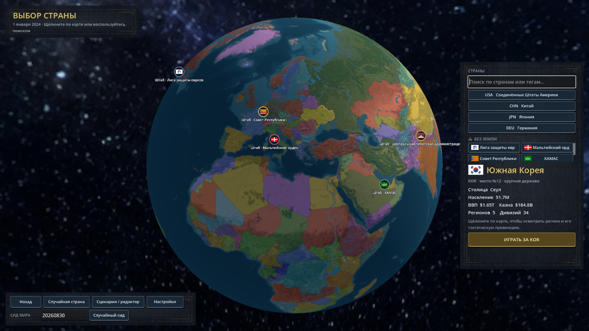
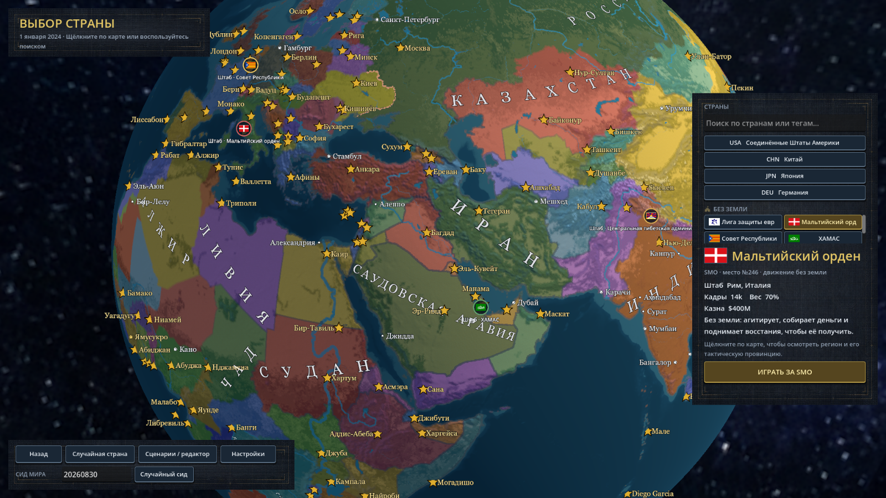

# Привязка названий движений — 4 октября 2026

Подпись штаба закреплена непосредственно под его значком. При отдалении, повороте
камеры и переключении между глобусом и 2D-картой она больше не переносится вниз
для обхода других названий. Подпись остаётся видимой вместе со значком:
пересечения с названиями городов не переключают её видимость. Города размещаются
с учётом занятого подписью места. На обратной стороне глобуса весь штаб скрывается
вместе со своим названием.

Исправления:

- Удалены накопление вертикального смещения и задержка перерасчёта после движения камеры.
- В группе штабов каждое название привязано к собственному значку, а не к центру группы.
- Расчёт размеров и попадания клика соответствует перспективной и ортографической проекциям.
- Скрытые названия столиц больше не оставляют старые области пересечения.
- Названия штабов не зависят от прямоугольников городов предыдущего кадра: это
  исключает циклическое скрытие и мигание при движении камеры.
- Клик по штабу обрабатывается перед выбором страны под ним. В выборе страны он выбирает
  само движение; в кампании используется существующая панель движения.

Проверка в Godot 4.7.2 .NET: успешная Debug-компиляция; шесть положений камеры,
720 проверок привязки и видимости на кадрах движения, четыре визуальных снимка. Отдельно
проверены клики по SMO на глобусе и CCR на 2D-карте: оба выбирают нужное движение,
включая штаб рядом с названием столицы. Перетаскивание глобуса средней кнопкой мыши:
ещё 200 проверок видимых штабов, ни одной скрытой подписи. На предыдущем варианте
этот же тест смены ракурсов обнаруживал 126 скрытых подписей из 720 проверок;
на исправленном — 0.

В запуске остаются два прежних предупреждения о целочисленном делении в
`Scripts/Boot/boot_guard.gd`, строки 229–230. Эти строки не изменялись.

