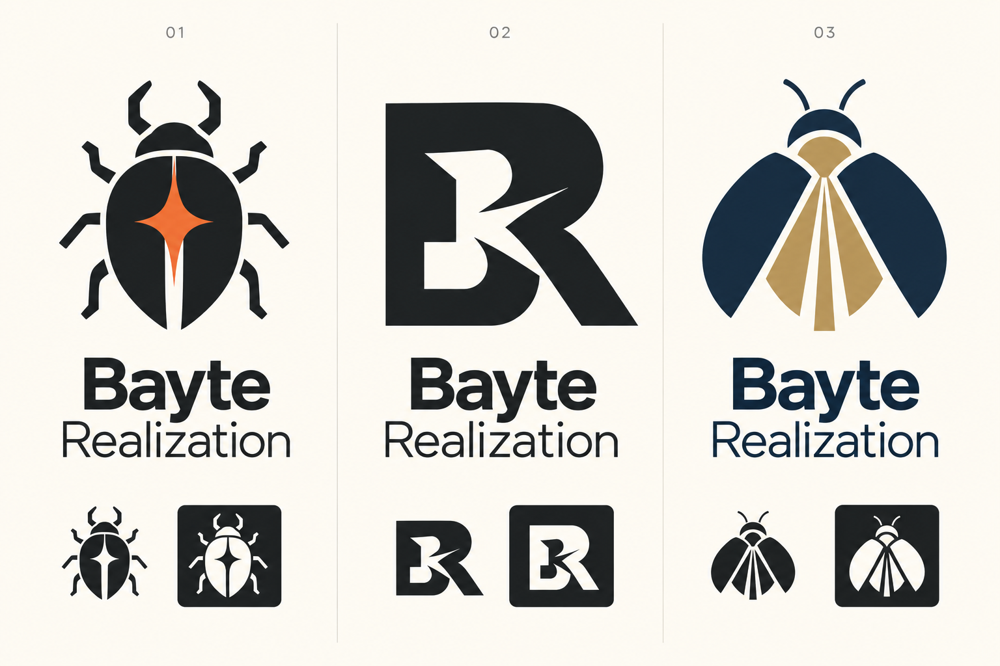

# Bayte Realization — первые направления знака

Статус: растровый лист идей, не утверждённый фирменный знак и не векторный оригинал.
В игру, заставку и лаунчер ничего не подставлено. Название сохранено именно как
**Bayte Realization**, не исправлено на Byte или Bite.

Основа — рассказ основателя: 4 августа 2026 года укус жука прервал состояние апатии
и стал поводом начать действовать. В знаке интересен не сам укус или боль, а момент
перехода от неподвижности к действию, от замысла к воплощению.



## Направления

1. **Жук-искра.** Комбинированный знак: геометрический жук и вспышка между надкрыльями.
   Самая личная связь с историей; самостоятельная иконка для аватара и будущего интро.
   Уверенный геометрический гротеск; проектная палитра угля `#202526`, огня `#EF762F`
   и тёплого фона `#F8F5ED`. В окончательной версии проверить тонкие просветы и упростить
   лапки для 16–24 px. Это направления цветов, не точные образцы сгенерированного файла.
2. **BR-разлом.** Монограмма с резким внутренним срезом: решение нарушить неподвижность.
   Строже, компактнее, удобна для монохромного штампа. Плотный геометрический гротеск,
   уголь `#202526` / светлый `#F8F5ED`; меньше личной истории, больше студийной строгости.
3. **Раскрытие.** Открывающиеся надкрылья и луч между ними: воплощение идеи.
   Более спокойная, открытая интонация; гротеск с более лёгкой второй строкой.
   Направление палитры: полночь `#142F44`, латунь `#B79650`, фон `#F8F5ED`.

Предпочтение текущего прохода — № 1. Последующее интро можно строить на замкнутом
силуэте, короткой вспышке в щели и появлении названия, без буквальной сцены укуса.
Это только предложение, а не реализованная анимация.

## Дальше после выбора

Отрисовать чистый вектор; проверить уникальность названия/знака перед коммерческим
использованием (поиск товарных знаков здесь не выполнялся). Подготовить горизонтальную,
вертикальную иконку/подпись, белую/чёрную версии и прозрачный PNG. Охранное поле —
не меньше высоты B в подписи. Проверить 16/24/32/64 px и 1080p-заставку; текущий лист
не считается доказательством читаемости 16 px. Не подменять исходники SVG трассировкой
всего листа с фоном. Точная гарнитура ещё не выбрана: изображение не включает файл шрифта.

## Генерация

Встроенный image generation, новый рисунок без референсов; не CLI и не ручная SVG-заглушка.
Файл: `docs/design/bayte-realization/concepts-2026-10-27.png`.
Сохранён оригинальный растровый лист; альфа-канал/готовый логотип не заявлены.

Финальный промпт (verbatim):

```text
Use case: logo-brand. Asset type: a single polished landscape studio-logo concept comparison board, three equal vertical columns on a plain warm ivory background. Design three ORIGINAL mature, memorable visual identities for the video game studio "Bayte Realization" (exact spelling B-A-Y-T-E, not Byte or Bite). The founding story: on 4 August 2026 an unexpected beetle bite interrupted the founder’s apathy and became a decision to ACT and make things real. Interpret transformation and agency, not injury or suffering. No literal leg or wound. Left concept numbered "01": a bold geometric beetle seen from above, its compact split shell containing a crisp ignition-spark/forward-motion negative-space cut; six short simplified legs, strong distinctive silhouette, charcoal with one ember-orange accent. Middle concept numbered "02": custom interlocking B/R monogram with one purposeful break or notch, like a static block suddenly opening into motion; near-black with warm ivory negative space. Right concept numbered "03": a minimal insect opening its two protective wing cases, geometry suggesting a rising ray and the passage from an idea to realization; deep midnight blue with restrained brass gold. Make each mark striking and simple enough for a small studio ident, not an esports mascot or generic technology icon. Under each large mark put a balanced two-line wordmark, exact text "Bayte" and "Realization", refined legible contemporary sans-serif typography, careful optical spacing. At the bottom of each column provide a small black-only silhouette and a reversed white-only silhouette of that same mark, showing it works without color. Tiny concept numbers only; no invented slogans, no extra prose, no dates. Perfect optical centering, generous equal whitespace, clear hierarchy, flat vector-like shapes, no gradients, no 3D, no photography, no mockup merchandise, no existing trademarks, no watermark. This is one coherent design exploration sheet, not a finished vector source.
```
