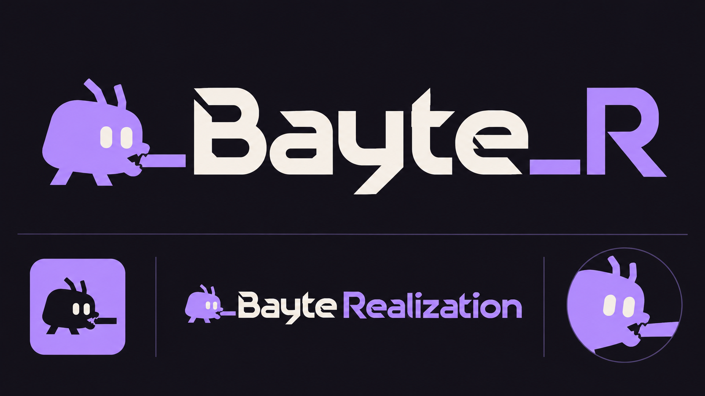
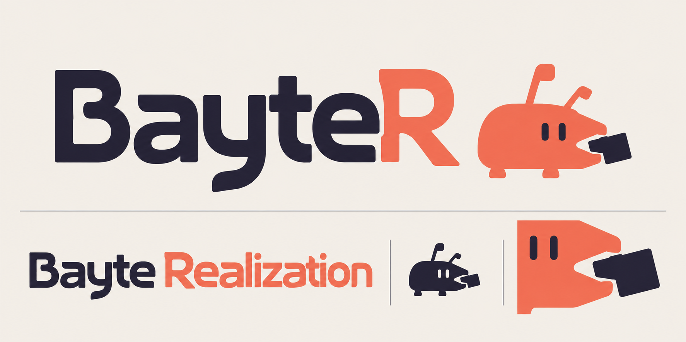

# Bayte Realization — цифровой персонаж, который сам кусает

27 октября 2026. Два новых растровых направления для выбора, не утверждённый знак.
В игру и лаунчер не установлены. Использована встроенная генерация изображений,
не API/CLI. Обе картинки просмотрены; старые варианты не перезаписаны.

## Фиолетовый Bayte_R



Компактный цифровой персонаж с собственным силуэтом и двумя глазами прикусывает
отдельную черту. От идеи 👾 взята компактность, не задано копирование конкретного
эмодзи. Полное название разделено на светлое Bayte и фиолетовое Realization.

Смысловая идея — персонаж прикусывает именно подчёркивание короткой подписи.
В полученном эскизе генератор добавил ещё одну черту перед Bayte: при векторной
доводке убрать дублирование, связать персонажа с единственным настоящим `_`.
Тонкие диагональные срезы букв тоже стоит упростить для маленького размера.

## Коралловый BayteR



Более мягкое начертание и активный персонаж, прикусывающий внешний прямоугольный
элемент. Полное имя — тёмное Bayte и коралловое Realization. Слитное сокращение
BayteR с выделенной R. Укус пока читается также как удержание блока; движение челюстей
в будущем интро может сделать действие однозначным. Анимация не создавалась.

## Границы результата

Буквы — сгенерированное начертание в картинке, не файл шрифта и не готовый SVG.
Векторная геометрия, единый набор букв, малые размеры и поиск похожих товарных
знаков здесь не проверены. Не заявляется гарантированная уникальность.
Файлы оставлены в документации как концепты для обсуждения, не как игровые ассеты.

## Финальные промпты

### Фиолетовый

```text
Use case: logo-brand. Generate a sophisticated ORIGINAL brand-identity concept board for the video game studio "Bayte Realization", exploring its short signature "Bayte_R". A NEW strong art direction, NOT an edit of earlier images. The founder was bitten by a bug, prompting him to act. Crucial narrative: THE LITTLE BUG IS THE ONE DOING THE BITING, NOT A BUG WITH A BITE REMOVED FROM ITS BODY.

Design a small digital critter mascot with the compact expressive simplicity associated with the idea of the 👾 emoji, WITHOUT copying that emoji, Space Invaders, or any existing mascot. Not a zoological beetle, not a scarab. A novel compact slightly asymmetric soft-square / clipped pebble silhouette, two simple confident eyes, a couple of short angular feelers/feet, and a tiny pair of visibly active blunt mandibles on the right. Extremely economical, 5–7 bold shapes, icon-friendly. Playful determination, quiet personality, not angry esports or baby cartoon. Its body must be intact. The jaws bite AN EXTERNAL SHORT HORIZONTAL UNDERSCORE BAR. The bar is visibly between the little jaws. No damage or missing chunks on the back or body.

Make the typography the co-star: bespoke, exceptionally beautiful minimal geometric lettering, not a stock heavy sans font. Exact primary text "Bayte_R" (B-a-y-t-e-underscore-R), with open airy counters, lightly squared curves, one coherent family of 45-degree terminal cuts that echo the mascot's jaws, a distinctive custom B and a beautiful asymmetrical R leg; carefully spaced, sophisticated, restrained, easy to read. The underscore has the same thickness as the lettering stems and a tiny pressed-in jaw mark at its end. Strong original typography, no stencil excess, no illegible futuristic sci-fi alphabet. Ivory "Bayte" and soft electric violet "_R", color separation intentional. The mascot violet with two ivory eye cutouts.

Art direction: wide editorial identity plate, solid very dark aubergine-black #14121B backdrop, warm ivory #F6F1E9 and soft electric violet #B59AFF only. Absolutely FLAT ink colors, no gradients, no 3D or glow. Main upper two-thirds: ONE large, beautifully balanced horizontal signature, mascot at the beginning, the underscore-biting interaction shown clearly in a small secondary detail below rather than destroying main-wordmark legibility. Give the hero lettering a lot of breathing room. Bottom third: three precise small studies: icon-only avatar on a violet square, full-name horizontal signature exact text "Bayte Realization" with "Bayte" ivory and "Realization" violet in the SAME custom lettering system, and a close-up detail of the intact critter clamping the external underscore. Present as a coherent professional design system, NOT a grid of unrelated random logos. Only brand texts "Bayte_R" and "Bayte Realization"; no explanations, no invented slogans, no dates, no extra numbers. Original compositions only. No merchandise mockups, no busy frames, no insects with six detailed legs, no bitten bug, no stars, no BR monogram, no ordinary parentheses, no watermark. This is polished raster concept exploration; don't pretend to provide an actual font file or vector source.
```

### Коралловый

```text
Use case: logo-brand. ONE highly refined original identity concept sheet for video game studio "Bayte Realization", short signature "BayteR". A distinct second direction: quiet designer typography, an expressive little digital bite-creature, sophisticated minimalism with personality. NOT a generic gaming logo or a stock font plus icon.

Wide landscape, warm porcelain #F4F0E8 background, very dark indigo #252239 and ember/coral #F2664E as the two brand inks. Absolutely flat shapes, no texture, no gradient, no glow, no shadow. Architectural whitespace and obsessive optical alignment.

Hero: large horizontal logo "BayteR", exact spelling B-a-y-t-e-R. "Bayte" dark indigo and final "R" coral. Bespoke semi-geometric humanist lettering: elegant medium-heavy strokes, softly squared bowls, single-storey a, an unusually graceful hooked y, generous open counters, a distinctive R leg subtly resembling a small forward step. Uniform clean strokes, minimal rounded wedge terminals shared with the mascot, no excessive diagonal cuts, no pseudo-Japanese or sci-fi stencil type, no plain Arial/Helvetica. Make the letterforms feel actually designed and original while remaining effortless to read. The capital R is part of the same word, not a separate label; equal baseline and cap-height. No underscore in this direction.

An ORIGINAL compact digital critter sits beside the hero lettering, a low, wide clipped-rectangle body with two tiny offset eyes and two short asymmetric feelers, just two simple stub feet, and a pair of small sharp-but-friendly geometric jaws projecting out of the RIGHT FRONT. The critter has the simple personality and compactness of the abstract IDEA of the 👾 emoji, but its silhouette must NOT resemble the exact standard emoji or Space Invaders characters. Think a tiny original digital animal with a mischievous determined stance, not an actual anatomical beetle and not an angry esports creature. Coral intact body, indigo eye slits. It is ACTIVELY BITING a separate small solid indigo rectangular tile held between its clearly opposing mandibles. The tile is visibly external to its body. The bug is the biter, never bitten; NO bite-shaped missing chunk from the bug. Few shapes, reproducible by hand, no complex limbs or teeth.

Lower area: full-name horizontal lockup "Bayte Realization", "Bayte" dark indigo and "Realization" coral using the SAME bespoke lettering; one small icon-only study in single indigo ink; one beautifully enlarged clean close-up of the jaws gripping the external tile. Small studies must repeat the SAME mascot, not reinvent it. Exact brand text only, no labels, no slogans, no explanation, no decorative numbers. Hero and full-name lockup should feel composed as a professional brand system, not a busy collage. Broad margins, one restrained hairline divider. No wings, no realistic beetle shell, no bitten cookie, no BR monogram, no famous trademarks, no merchandise mockups, no watermark. Raster identity concept, not an actual font file.
```

